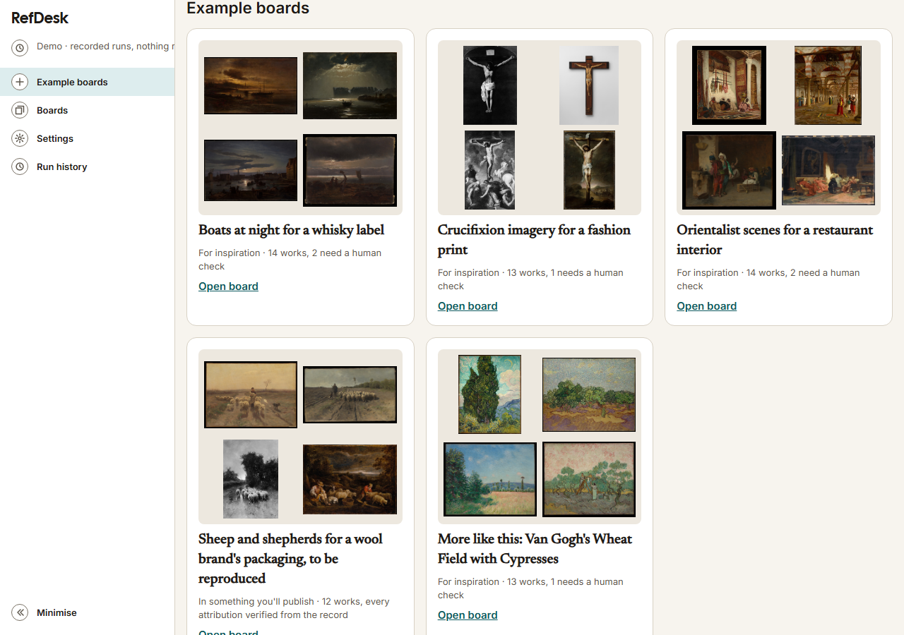
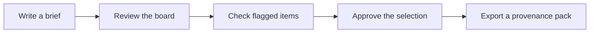
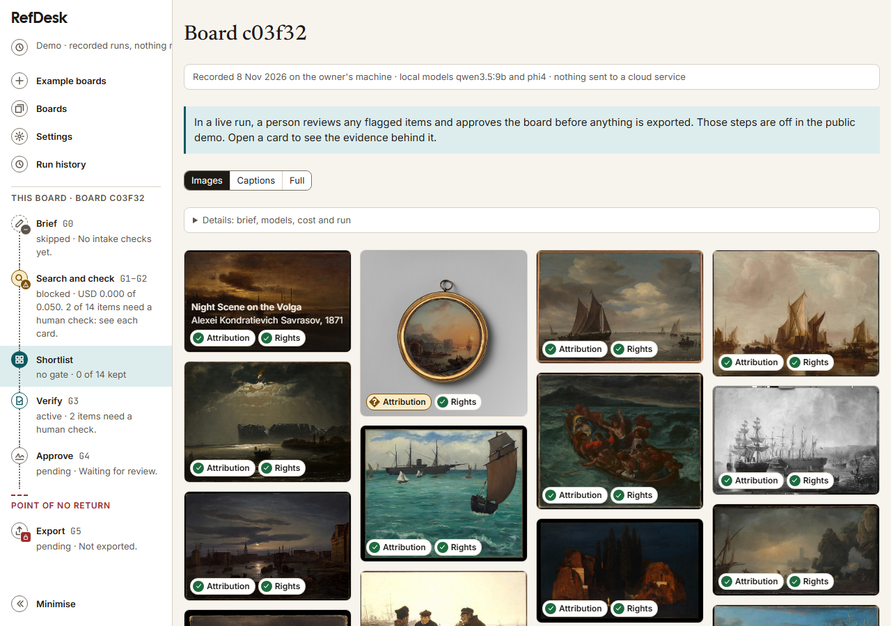
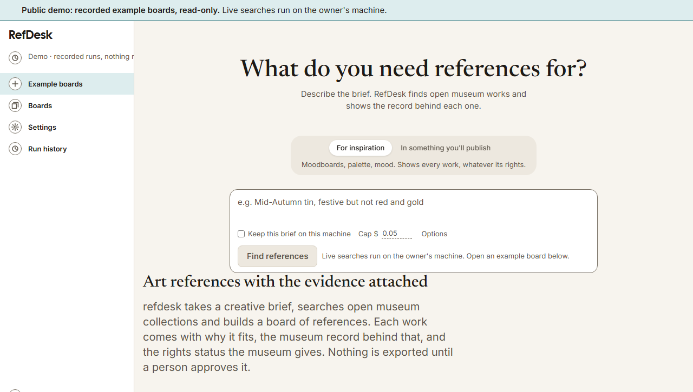
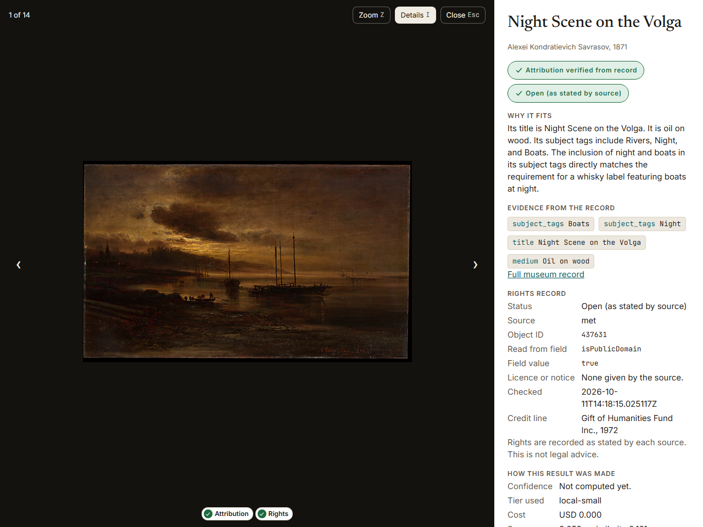
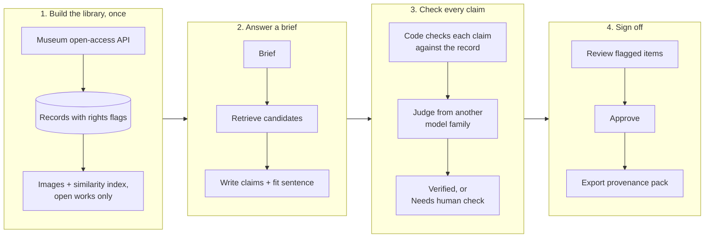
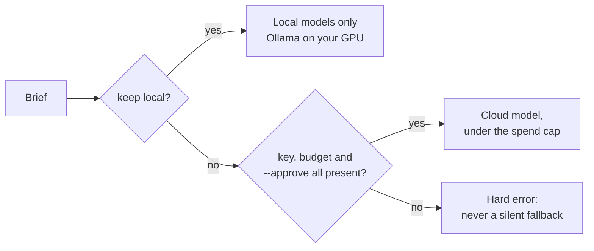
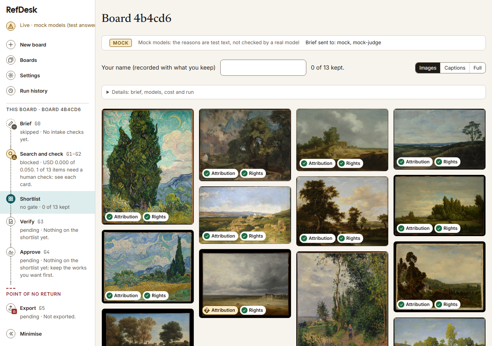

# refdesk

**Art references you can actually use, with the reasons and the paperwork attached.**

Designers and art directors often want paintings from museum collections for a pitch, a campaign or a brand. Finding them means searching museum sites one by one, guessing which works are free to use, and copying credit lines by hand. Search results come back on keyword matches, with no reason given for why a work fits.

refdesk takes a creative brief ("quiet interiors, soft north light, muted greens") and returns a board of public-domain paintings from open museum collections. Each result comes with:

- **a short explanation** of why it fits, in the brief's own terms, with every factual claim checked against the museum's record;
- **a rights trail**: where the work came from, the rights flag the museum gives it, and when that was checked;
- **a clear flag** when something could not be verified, so a person looks at it before anything is used.

It runs on your own machine by default, and uses a cloud model only under a spend cap you set.

**Live demo: [refdesk-demo.onrender.com](https://refdesk-demo.onrender.com)** (recorded example boards, read-only; the free host can take up to two minutes to wake). Every board shows its run ID, models, gates and full step log, so it can be checked, not just viewed.

[](https://refdesk-demo.onrender.com)

## The project in brief

**The problem.** A designer's brief is vague ("boats at night for a whisky label"), and the hard part is not finding pictures but finding ones they can *use*: the right rights status, a correct credit line, and a reason it fits that holds up when a client asks. Keyword search gives none of that, and a language model on its own will happily invent attributions.

**The requirements I turned that into.**
- Every factual claim on a board traces to a field in the museum's record, or is flagged for a person.
- Rights come only from the museum's own flag, shown as stated, never inferred.
- Nothing is exported until a named person approves it, and the server, not the UI, enforces that.
- Local models by default; any paid call needs a key, a budget and an explicit `--approve`, with no silent fallback.

**What I built.** A FastAPI service and React UI over 2,588 Met paintings: retrieval (metadata, CLIP and a combination), a generator that writes claims tied to record fields, code that checks each claim, a judge from a different model family (`phi4`) that checks each one again, approval gates, a provenance-pack export, a read-only MCP server, and an evaluation harness. Deployed as a non-root, scanned container on Render, with a read-only demo profile enforced by the API and proved by a test.

**How I know whether it works.** Evaluation came before claims. The first golden set was synthetic and is used only to test the harness. For the hand-labelled set (`golden-v1`), Claude proposes labels and phi4 checks them, and I review every one. Two trust rules decide whether that set can be frozen: my own blind labels measure how far the proposals agree with me, and an anchoring check measures whether seeing a proposal biased my review. Round 1 failed the anchoring check: in review I changed far fewer labels than I disagreed with when labelling blind. So round 2 adds blind cases and a relabel, instead of publishing a number I couldn't defend. See [`docs/adr/ADR-018-golden-set-synthetic-v0.md`](docs/adr/ADR-018-golden-set-synthetic-v0.md).

**What broke, and what I did.** Recording the demo boards exposed three gaps, now tracked: style requests for in-copyright artists are not declined yet ([#217](https://github.com/sycrus/refdesk/issues/217), decision contract written); a period stated in the brief ("twentieth-century") is ignored unless set as a condition; and the opinion flag fires on most items, which is noise. Building the demo image also caught my own design mistake (baking images the UI never used) when 12 of 65 Met images had changed within a month; it is in the [AI-assist log](docs/ai-assist-log.md).

**What's next.** Freeze `golden-v1` and publish retrieval and rationale results with intervals; fix the period gap with a before-and-after eval; build the intake decline; compare a Mistral model (Ministral 3 14B) against the current generator on the same eval.

## How you use it





1. **Write a brief.** Describe the mood, subject or style you want. You can add conditions (a period, material or motif) and choose whether the brief may leave your machine.

   

2. **Review the board.** The board opens on the images: a grid of the works found, name and rights badge a click away. Captions and full cards are one click away, and every board states how it was made (see [Where a brief is sent](#where-a-brief-is-sent)).
3. **Check flagged items.** Anything refdesk could not verify is marked *Needs human check*, with the exact claim that failed. Keep it with a note, or drop it.
4. **Approve.** An approver signs off on the selection. refdesk does not let anything be exported before that.
5. **Export.** Download a provenance pack (CSV): every work with its source, rights basis, credit line and the date it was checked.

If a result looks wrong, use **This is wrong** on the item to report it. The report is queued for review; the board itself is not changed.

Opening any work shows the evidence behind its card — why it fits, every claim with the record field it came from, and the rights record as the museum states it:



## How it works

### The pipeline



Three ideas carry the design:

- **Facts come from records, not from the model.** The model writes claims that each point at a field in the museum's record (artist, date, medium). Code checks every claim against that field. A model never makes up an attribution, date or rights status: if it can't be read from the source, it is marked *Unverified*.
- **Nothing marks its own homework.** The judge that checks claims always comes from a different model family than the one that wrote them.
- **The gates live in the API.** Review, approval and export are enforced on the server. The UI only shows their state, so it can't skip a step.

### Where a brief is sent



By default everything runs locally, or against a mock model server for tests. Every board records where its brief was sent, and says so: a line under the wordmark and on each board gives the mode — mock, local, cloud or search-only — and any board the mock server answered also carries a **Mock** tag on its strip and its Boards card, so test answers are never mistaken for real ones.

## Quick start

Commands work in PowerShell or WSL2. Run the stages in order; each builds on the one before. `uv run python -m refdesk --help` lists every command.

**You need:** [uv](https://docs.astral.sh/uv/), Node.js with npm (for the UI), and optionally [Ollama](https://ollama.com/) and an NVIDIA GPU for real models and image similarity.

### Stage 1: Install and test

Installs the Python dependencies and runs the test suite. The tests run offline and need no data or keys.

```
uv sync
uv run pytest -q
```

Add `--extra embed` to `uv sync` if you want image similarity (Stage 2c). It adds PyTorch and OpenCLIP, about 3 GB, and needs the GPU.

**You now have:** a working install, verified by the tests.

### Stage 2: Get the data

**2a. Ingest records.** Fetches the Met's European Paintings records into a local SQLite store under `data/`. This takes about 45 minutes at one request per second. It is resumable, so you can stop and re-run it. Use `--limit N` for a quick partial run.

```
uv run python -m refdesk ingest met
uv run python -m refdesk stats
```

**2b. Cache images.** Downloads images from the Met's own image host, for open works only.

```
uv run python -m refdesk images met
```

**2c. Build the similarity index (optional).** Builds the CLIP index from the cached images. It needs `--extra embed` and the GPU. Skip it if you only use the metadata retriever (`jaccard`).

```
uv run python -m refdesk embed met
```

**You now have:** about 2,600 records with rights records, and images for the open ones.

### Stage 3: Run the app

**3a. Start the mock model server.** It gives deterministic answers, so you can try the whole flow without a GPU or keys. Leave it running.

```
uv run python -m refdesk.llm.mock_server --port 8100
```

**3b. Build the UI and start the API.** The API serves both the UI and the endpoints. Set `REFDESK_RETRIEVER=jaccard` first if you skipped 2c.

```
cd ui; npm install; npm run build; cd ..
uv run uvicorn refdesk.api.app:app --port 8000
```

**You now have:** refdesk at http://localhost:8000. Write a brief and follow the flow in [How you use it](#how-you-use-it).



### Stage 4: Go further (optional)

**Use real local models.** Pull `qwen3.5:9b` and `phi4` in Ollama. Copy `.env.example` to `.env` and set both `REFDESK_GENERATOR_TIER=local-small` and `REFDESK_JUDGE_TIER=auto` (set both, or the judge stays the mock). Then start the API with the env file. You no longer need the mock server.

```
uv run --env-file .env uvicorn refdesk.api.app:app --port 8000
```

refdesk never reads `.env` itself; it is loaded per command. Don't set `UV_ENV_FILE` globally, or `pytest` will use the real models. `REFDESK_GENERATOR_TIER=none` gives retrieval-only boards.

**Run an evaluation.** Scores a retriever against the golden set and writes a report named with its config hash. Compare two runs by their hashes (`--write` saves the comparison).

```
uv run python -m refdesk eval --retriever jaccard
uv run python -m refdesk compare <hashA> <hashB>
```

**Connect an AI assistant (MCP).** A read-only MCP server that calls the API over HTTP. See [MCP server](#mcp-server) for the tools and client setup.

```
uv sync --extra mcp
uv run python -m refdesk.mcp_server
```

**Before committing:** `uv run python scripts/verify.py` checks frozen golden files, `.env` and secrets.

## Project status

Built end to end: ingest with rights records, two retrievers, checked rationales, review, approval, export with a provenance pack, "This is wrong" reports, a read-only MCP server, an evaluation harness, and a hosted demo ([refdesk-demo.onrender.com](https://refdesk-demo.onrender.com)) built from the same container image anyone can run.

Not yet a product claim: every evaluation so far uses a **synthetic** golden set, built only to test the harness. The hand-labelled set is in its second round ([#15](https://github.com/sycrus/refdesk/issues/15)); then come a quality bar for rationales ([#102](https://github.com/sycrus/refdesk/issues/102)) and public results ([#178](https://github.com/sycrus/refdesk/issues/178)). Work is tracked in [GitHub Issues](https://github.com/sycrus/refdesk/issues).

## How it was built: with a coding agent, under rules

Most of the code was written with Claude Code, as an agent working through GitHub Issues: 280 commits, 121 merged PRs and 96 closed issues since 11 October 2026. The point was not speed alone, so the agent works under rules that keep the system explainable and the decisions mine:

- **Permissions.** Pushing, merging, new dependencies, `gh api`, Docker, pulling models and any `--approve` (paid) run all wait for me ([`.claude/settings.json`](.claude/settings.json)). The agent may not widen its own permissions.
- **Decisions stay human.** Golden-set labels, ADR reasoning, decision-contract costs and residual-risk calls are mine; the agent drafts scaffolding and asks ([`CLAUDE.md`](CLAUDE.md), "Learning mode").
- **Tests first** for scorers, adapters, loop controls and rights logic; CI runs the Python suite, the UI tests, browser tests with an accessibility check, and a container build, smoke test and scan on every PR.
- **Every AI-introduced defect is logged** with how it was caught and fixed: 36 so far, in [`docs/ai-assist-log.md`](docs/ai-assist-log.md). They include a broken workflow file, a test that only passed locally, and a design mistake caught by CI.
- **Decisions are written down**: 26 ADRs in [`docs/adr/`](docs/adr/), each with the options rejected and why.

## Technical details

### Data

The Met's European Paintings slice: **2,588 records** (2,308 open, 280 permission required, 0 unverified). Each record keeps its raw API response and a rights record read from the Met's own `isPublicDomain` flag. Ingest is resumable and idempotent, and `rebuild` re-derives records from stored responses with no network. Images are cached for open works only, from the Met's image host only.

### Retrieval

Two baselines behind one interface: a metadata baseline (Jaccard over field-named attributes) and a CLIP similarity baseline (OpenCLIP with an exact FAISS index), plus a weighted combination of the two. In reproduction mode every retriever returns open works only, through one shared rights filter.

### Rationales and verification

The generator (local `qwen3.5:9b`) writes claims that each name a record field, plus one sentence on fit. Plain code checks every claim against the record, then `phi4` checks each claim on its own. Any failure makes the item *Needs human check* and names the claim. A fit sentence that may state a fact gets an opinion flag (ADR-022). Fixed status wording lives in one file (`src/refdesk/wording.py`), so labels never drift between API, UI and reports.

### Models and spend control

One LLM client for every provider. Before any request it checks keep-local, key, budget, approval and the worst-case cost against what is left of the budget; every failure is a hard error with no fallback. Paid calls need a key in `.env`, a budget in `config/budgets.yaml`, and a run with `--approve` after a dry-run estimate. A GPU `ModelManager` keeps one model loaded at a time, using measured VRAM needs from `config/models.yaml`.

### Evaluation

A golden-set validator, capped recall@k, MRR, an open-rights share, seeded bootstrap intervals, run manifests with a config hash, paired comparison of runs, and a gate policy. Corpus snapshots pin each golden set to the records it was labelled on. A rationale eval reports verifier pass rates. For `golden-v1`, a local labelling page, an independent check by `phi4`, and a trust report that must pass before the set is frozen (ADR-018).

### API and UI

FastAPI with a small static React UI (Vite + TypeScript) served by the API. The board is image-first: the grid of works opens first, captions and full cards are a click away, and a work opens in a lightbox with its evidence. A `/design` page shows every component, checked with axe in CI. The OpenAPI spec is in [`docs/api/openapi.json`](docs/api/openapi.json).

### MCP server

A separate process that calls the API over HTTP and never duplicates its logic (ADR-015). Seven read tools: `list_runs`, `get_run`, `get_record`, `get_rights_record`, `search_references`, `get_image` and `get_provenance`. Nothing through MCP can approve, export, file a report or start a board, and results are marked as untrusted museum data. Point it at another API with `REFDESK_API_URL` (default `http://127.0.0.1:8000`).

```
uv run python -m refdesk.mcp_server                              # stdio
uv run python -m refdesk.mcp_server --transport http --port 8765 # http://127.0.0.1:8765/mcp
```

The HTTP transport binds to `127.0.0.1` only until auth and scopes land (#201). `uv sync --extra mcp` removes the `embed` extra; to keep both, run `uv sync --extra embed --extra mcp`.

Claude Code:

```
claude mcp add refdesk -- uv run --extra mcp --directory C:\path\to\refdesk-kit python -m refdesk.mcp_server
```

Claude Desktop (`claude_desktop_config.json`):

```json
{"mcpServers": {"refdesk": {"command": "uv", "args": ["run", "--extra", "mcp", "--directory", "C:\\path\\to\\refdesk-kit", "python", "-m", "refdesk.mcp_server"], "env": {"REFDESK_API_URL": "http://127.0.0.1:8000"}}}}
```

## Design decisions

refdesk has two goals, judged separately (PRD Section 3): a **product hypothesis** (this workflow beats the alternatives for small studios) and a **demonstration** of designing, evaluating, governing and running an AI system. Each significant choice is recorded as an ADR in [`docs/adr/`](docs/adr/).

| Area | Decision | Why, in short | ADR |
|---|---|---|---|
| Decision model | Kev-4B behind one decision contract; fine-tune only if it wins by a significant margin | Don't pay for training until a baseline proves it isn't enough | 001 |
| Golden sets | Synthetic v0 for the harness only; v1 proposed by Claude, checked by phi4, every label reviewed by the owner | Synthetic data tests the plumbing, never the product | 018 |
| CI | GitHub Actions on every PR | Cheap, standard, enough for now | 019 |
| Generators | Local `qwen3.5:9b`; cloud `deepseek-flash` | Local first; cloud only under a cap | 020 |
| Judge | Local `phi4`, one claim at a time, never the generator's family | A model shouldn't grade its own family's work | 021, 022 |
| Scope | Focus on evals, a public proof and the demo; MLOps work parked | Spend the time where the evidence is | 024 |
| Demo | Hosted demo on recorded runs; live sessions on the owner's machine | The chosen models are local, so a live public demo would need paid ones | 025 |

## Where things are

| Path | What |
|---|---|
| [`docs/prd.md`](docs/prd.md) | The working spec |
| [`docs/problem-statement.md`](docs/problem-statement.md) | The decision refdesk improves, and how we'll know |
| [`docs/architecture.md`](docs/architecture.md) | What is built and how it connects, module by module |
| [`docs/adr/`](docs/adr/) | Decisions |
| [`docs/data-sources.md`](docs/data-sources.md) | Licences, rights flags, rate limits, drift |
| [`docs/eval-gate-policy.md`](docs/eval-gate-policy.md) | Metric definitions, noise, gates |
| [`evals/`](evals/README.md) | Golden sets, labelling files and reports |
| [`docs/usability/`](docs/usability/README.md) | Usability test protocol and templates |
| [`docs/ai-assist-log.md`](docs/ai-assist-log.md) | Defects introduced by AI assistance, and how they were caught |
| [`design/`](design/) | Design tokens, brand book and component specs |
| `config/` | Providers and tiers, budgets, measured model VRAM |
| `src/refdesk/` | The code |

## Rights

refdesk records what each museum states. It is not legal advice. Only collections whose terms and machine-readable flags confirm open use are ingested; permission-required collections (including Singapore national collections) are not scraped. Images are fetched only for works the source marks as open, and only from the source's own image host.
