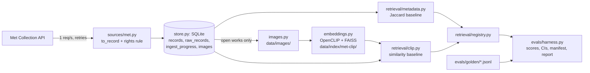
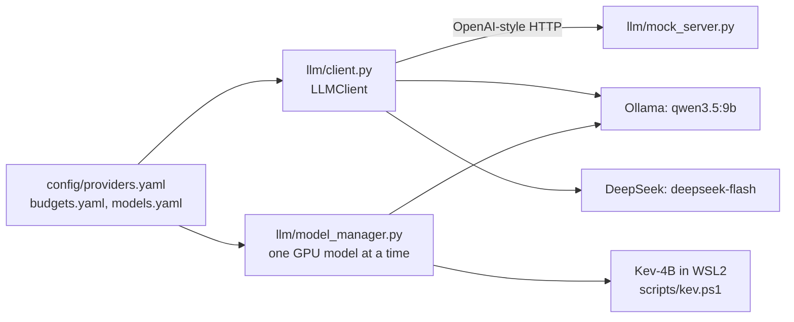

# Architecture (as built, 12 October 2026)

What exists in `src/refdesk/`, how the parts connect, and what comes next. The design intent is in `docs/prd.md` (Section 10); decisions are in `docs/adr/`. This page describes the code as it is.

## Data and retrieval path

| Module | What it does | What breaks without it |
|---|---|---|
| `schema.py` | `ArtworkRecord` and `RightsRecord`. "Open" only with a structured flag; unknown rights are "Unverified"; descriptive fields stay empty rather than invented. | An adapter bug could store an open status with nothing behind it. |
| `wording.py` | Every fixed status label (rights, attribution, stop banners) in one file. | Labels drift between API, UI and reports. |
| `sources/met.py` | Met adapter: maps a raw object, applies the rights rule (`isPublicDomain`), polite client (throttle, backoff, image host allow-list, URL encoding). | No data; or images fetched from arbitrary URLs in museum data. |
| `store.py` | SQLite: records (upsert), raw responses, ingest progress (including skips), image cache index. Record, raw and progress written in one transaction. | No resume; duplicates; facts not traceable to the raw response. |
| `ingest.py` | Resumable, idempotent ingest; `rebuild` re-derives records from stored raw responses with no network. | A mapping fix would need a full re-fetch. |
| `images.py` | Caches images for open works only, atomically, with sha256. | No image embeddings; risk of fetching non-open images. |
| `embeddings.py` | FAISS exact index over normalised CLIP vectors; manifest skips unchanged rebuilds; VRAM check before loading. | No similarity retrieval. |
| `retrieval/` | `Query`, `Hit`, `Retriever` protocol; rights filter `allowed()` shared by every retriever; Jaccard and CLIP retrievers; registry with lazy resources. | Retrievers would diverge on rights and avoid lists. |
| `evals/` | Golden-case format and validator, rule engine (golden-v0), scorers, bootstrap CIs, harness, paired comparison, judge probe. | No measured claims. |

## Model path

- **`LLMClient`**: one client for every provider. Before any request it checks keep-local, model and price present, key, budget, approval, and the worst-case cost against the remaining budget. Every failure is a hard error with no fallback. It retries 429, 5xx and timeouts against the same provider, refuses empty answers, and records the model each response reports.
- **`ModelManager`**: unloads every other model, checks free VRAM against the measured need in `config/models.yaml`, loads, and logs the load time.
- **Mock server**: deterministic answers with scripted failures (latency, 429, 500, timeout), used by tests and the M5 drills.

## API

`api/app.py` is a FastAPI skeleton with the full contract from PRD 13A (`docs/api/openapi.json`, generated from code and checked by a drift test). Every endpoint except `/healthz` returns 501 until implemented. Gate rules already enforced by the models: approval needs an explicit acknowledgement, keeping a flagged item needs a note, and approve/export are tagged `gates` so MCP can never expose them.

## Commands

All via `uv run python -m refdesk <command>` (PowerShell or WSL2):

| Command | Does |
|---|---|
| `ingest met [--refresh] [--recheck-skipped] [--limit N]` | Resumable ingest of the Met paintings slice |
| `rebuild met` | Re-derive records from stored raw responses (no network) |
| `images met` | Cache images of open works |
| `embed met [--model] [--pretrained]` | Build the FAISS index (needs `uv sync --extra embed`) |
| `eval [--retriever jaccard\|clip] [--k 12]` | Run a retriever on a golden set; write manifest, report, history |
| `compare HASH_A HASH_B` | Paired comparison of two eval runs |
| `stats` | Record counts by rights status and ingest progress |

Also: `uv run python -m refdesk.llm.mock_server`, `scripts/judge_probe.py`, `scripts/build_golden_v0.py`, `scripts/record_met_fixtures.py`, `scripts/export_openapi.py`, `scripts/verify.py`, `scripts/run-loop.ps1`, `scripts/kev.ps1`.

## Not built yet

- Combined score of conditions and similarity (#34), the comparison report (#37).
- API endpoints beyond the skeleton (#45), the UI and design library (#41 to #46).
- M3: rationales as structured claims, the verifier (code checks, then Granite Guardian per claim, phi4 on the fit sentence), provenance pack, golden-v1.
- M4: routing labels, Kev-4B fine-tune and calibration, the loop controller, MCP server.
- M5: Docker, kind, drills, LangGraph port, bake-off.
