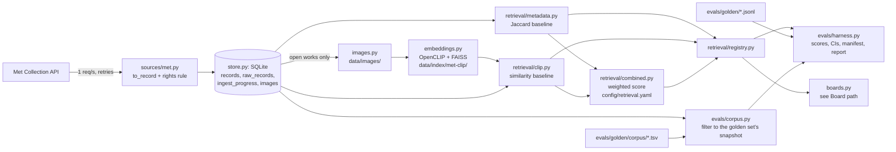
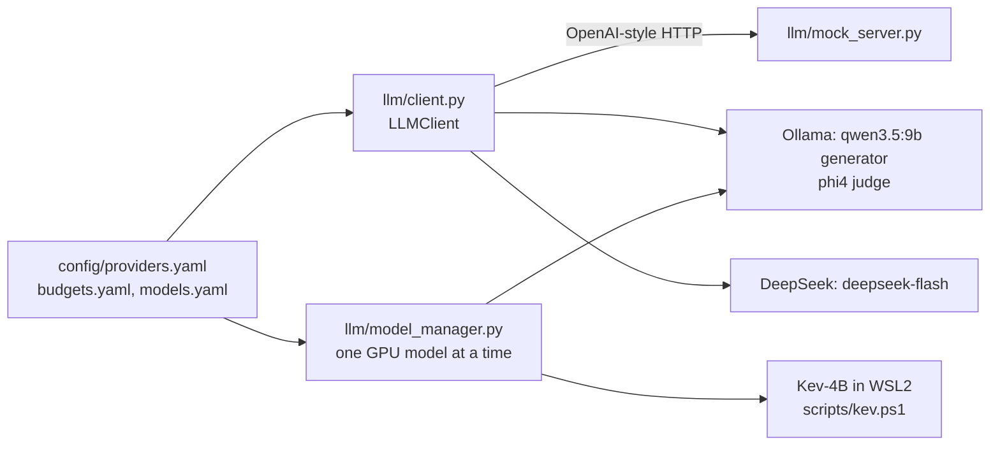
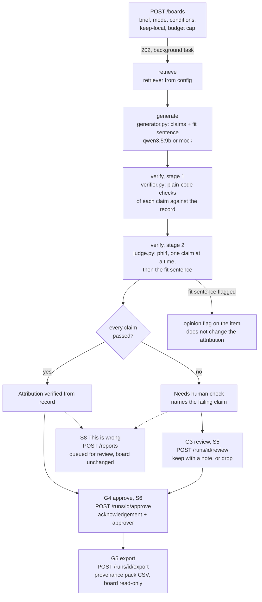
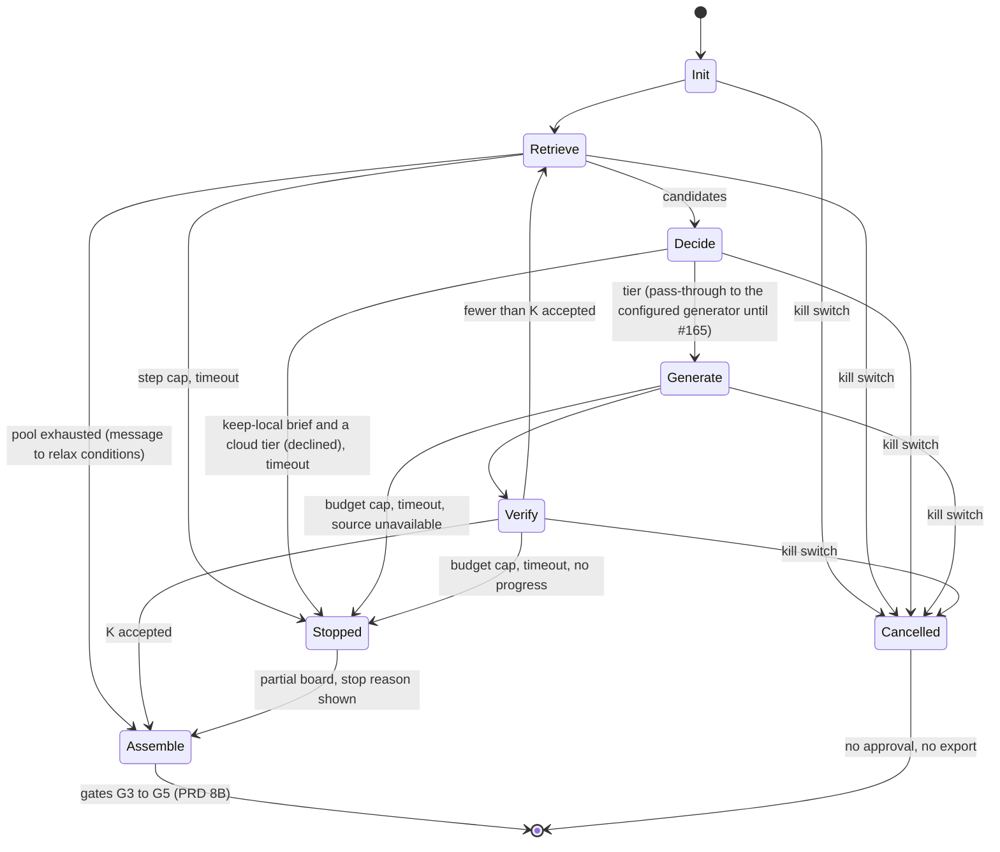
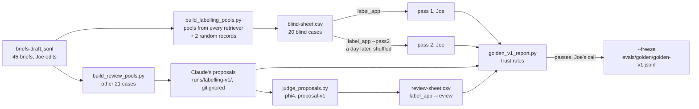

# Architecture (as built, 31 October 2026)

What exists in `src/refdesk/`, how the parts connect, and what comes next. The design intent is in `docs/prd.md` (Section 10); decisions are in `docs/adr/`. This page describes the code as it is.

## Data and retrieval path

| Module | What it does | What breaks without it |
|---|---|---|
| `schema.py` | `ArtworkRecord` and `RightsRecord`. "Open" only with a structured flag; unknown rights are "Unverified"; descriptive fields stay empty rather than invented. | An adapter bug could store an open status with nothing behind it. |
| `wording.py` | Every fixed status label (rights, attribution, opinion flag, stop banners) in one file. | Labels drift between API, UI and reports. |
| `sources/met.py` | Met adapter: maps a raw object, applies the rights rule (`isPublicDomain`), polite client (throttle, backoff, image host allow-list, URL encoding). | No data; or images fetched from arbitrary URLs in museum data. |
| `store.py` | SQLite: records (upsert), raw responses, ingest progress (including skips), image cache index. Record, raw and progress written in one transaction. | No resume; duplicates; facts not traceable to the raw response. |
| `ingest.py` | Resumable, idempotent ingest; `rebuild` re-derives records from stored raw responses with no network. | A mapping fix would need a full re-fetch. |
| `images.py` | Caches images for open works only, atomically, with sha256. | No image embeddings; risk of fetching non-open images. |
| `embeddings.py` | FAISS exact index over normalised CLIP vectors; manifest skips unchanged rebuilds; VRAM check before loading. | No similarity retrieval. |
| `retrieval/` | `Query`, `Hit`, `Retriever` protocol; rights filter `allowed()` shared by every retriever; Jaccard and CLIP retrievers; registry with lazy resources. | Retrievers would diverge on rights and avoid lists. |
| `retrieval/combined.py` | FR-3 score: `w_similarity x cosine + w_attributes x jaccard`, each hit's two terms in `Hit.components` (they sum to the score). Conditions boost or filter per field; records without an image vector rank on attributes alone. A condition it cannot apply raises `ConditionNotUnderstood` (API: 400). Weights in `config/retrieval.yaml` feed the eval config hash. | No search that uses both conditions and similarity; no per-hit explanation of a mixed score. |
| `evals/corpus.py` | Corpus snapshots (ADR-023): filters the store to the record IDs a golden set was labelled on before any retriever is built. Refuses if a pinned record is missing or its rights status changed; lists other changed records in the report and adds their hash to the config hash. | Every re-ingest that adds a work breaks every frozen golden set. |
| `evals/` | Golden-case format and validator, rule engine (golden-v0), scorers, bootstrap CIs, harness, paired comparison, judge probe, rationale eval, golden-v1 labelling. | No measured claims. |

## Model path

- **`LLMClient`**: one client for every provider. Before any request it checks keep-local, model and price present, key, budget, approval, and the worst-case cost against the remaining budget. Every failure is a hard error with no fallback. It retries 429, 5xx and timeouts against the same provider, refuses empty answers, and records the model each response reports.
- **`ModelManager`**: unloads every other model, checks free VRAM against the measured need in `config/models.yaml`, loads, and logs the load time.
- **Mock server**: deterministic answers with scripted failures (latency, 429, 500, timeout), used by tests and the M5 drills. It answers rationale prompts with claims built from the record block, and can be scripted to return `malformed`, `nofit` or `badfield` answers.
- **Thinking off for local qwen:** a tier may set `reasoning_effort` (sent as is); `local-small` uses `none`, because Ollama's OpenAI-style endpoint otherwise spends every token on reasoning.

## Board path (M3)

What happens to one brief, from S1 to the provenance pack. The API enforces every gate; the UI only shows them (PRD 8B).

Budget (G1) wraps generate and verify: a per-run client whose budget is the board's cap blocks any call that could exceed it, and the run stops with its reason shown. A retriever or model that cannot load stops the run with "source unavailable"; there is no fallback.

### Loop controller (issue #155, PRD 10.2)

`loop.py` runs retrieve, decide, generate and verify as an explicit state machine in plain Python (PRD 10.4 stage 1, the reference for the later LangGraph port). It builds towards K accepted items: an item counts only when the verifier passes it, so a round where everything is flagged goes back to Retrieve for the next ranked candidates. Flagged items stay on the board as "Needs human check".

- **Where each stop is checked.** Kill switch and timeout: before every step and before every model call (`Reasoner.run(before_call=...)` raises `Interrupted`), so a cancelled run reaches Cancelled before its next call. Budget cap: the LLM client, before each call, against what is left of the board's one cap across all rounds. Step cap: before each Retrieve. No progress: after Verify, when `stuck_rounds` rounds in a row add no accepted item. Pool exhausted: Retrieve returns nothing; with no items at all the run is Stopped, otherwise it assembles a partial board with the reason shown. Keep-local: Decide refuses a cloud tier before any call, and the client refuses it again.
- **Every stop is shown.** The run keeps a `StopReason` (fixed banner in `wording.py`) and a detail sentence, including a board that assembled because the pool ran out. `RunView.state` is `done` (assembled, no stop), `stopped` (assembled, partial) or `cancelled`.
- **Kill switch.** `BoardService.cancel` writes to a `cancellations` table, not into the stored view (the run's thread rewrites the view at every state). A cancelled run shows G4 and G5 blocked ("Run cancelled. Nothing was exported."), and approve and export refuse it (409). The endpoint and S2 button are #158.
- **Values** are in `config/loop.yaml`: PRD placeholders until Joe sets them (#154). `drop_after_failed_verifications` is loaded but not enforced: each candidate is generated once, with no regeneration retry yet.
- **What breaks without it:** one fixed pass would end "done" even when every item failed verification; there would be no step cap, timeout, stuck rule or kill switch, and the cap would apply per pass rather than per board.
- Not yet: checkpoint and resume (#157, scenario 3).

### Run log (issue #156, PRD 10.2 and 13A)

`runlog.py` writes an append-only `runs/<run_id>/events.jsonl` per run (gitignored). It is the trace view until Phoenix (M5-06).

`signals.py` reads those run logs and reports the golden signals for a batch (PRD 13A): board latency p50/p95 by tier, model-call error rate, saturation (cost cap and rounds used), cost per board, escalation rate and stop reasons. Run it with `uv run python -m refdesk signals --runs runs` (PowerShell or WSL2). It only reads redacted logs. Phoenix tracing, SLO targets and the fault-injected alert wait on #172's dependency decision.

- **Two kinds of event.** A `transition` event each time the loop enters a state, so the transition events match `LoopResult.trace` one to one. A `call` event for each tool call inside a step: each `retrieve` and each model request attempt (`LLMClient.observe`, retries included). Each event (`RunEvent` in `api/models.py`) holds the PRD fields: run ID, `seq`, step, state, round, tool, `args_hash`, result summary, tokens, cost, latency, model, adapter, probabilities and reason code. Decide logs the tier with `reason_code: router_not_built` and no probabilities until the router (#165). Stops carry the `StopReason` value as the reason code. A run that ends before the loop (retriever down, declined condition, no match) logs one event for how it ended.
- **Redaction.** Every string in an event is scrubbed of the brief before the line is written: any case, any whitespace, JSON-escaped, or cut off at the end of a string (the client keeps 200 characters of an error body). The serialised line is checked again. `args_hash` is the SHA-256 of the arguments *after* redaction, so it cannot be used to guess a short brief. Limits: it matches the whole brief, not single words or paraphrases.
- **Replay.** Call events keep the tool's recorded output (candidate records, the provider's raw status and body). `replay(path, brief=..., make_reasoner=...)` runs the loop again with the recordings standing in for the retriever and the model transport, so nothing leaves the process, and gives the same items, trace and stop reason. The Init event records the run's parameters (target, keep-local, cap, loop config, tier, prompt names). The kill switch and the timeout are replayed at the same guard check (`data.guard_check`, `data.elapsed_s` on the Stopped or Cancelled event). A request whose arguments differ from the recording raises `ReplayDiverged` naming the step; that is how a faulty step is found. Replay needs the brief (from the operator or the run store) to restore it into recordings and rebuild the hashes; a wrong brief diverges at the first model call.
- **`GET /runs/{id}`** returns `events` without the recordings (`recorded: null`); the file keeps them. The stored view in SQLite never holds the events.
- **What breaks without it:** a stopped or failed run leaves only its final view, so nobody can see which step went wrong or rerun it.

### Rationales and verification (ADR-022)

- **`rationale.py`** (issue #94): a rationale is JSON, a list of claims (`field`, `value`, `text`) plus a separate `fit` sentence. `parse_rationale` rejects non-JSON, missing fit, and any claim on a field records do not have or this record leaves empty. Claims may rest on title, artist, date, date_begin, date_end, medium, classification and subject_tags; never on rights, which come only from the rights record.
- **Prompts** are versioned files in `src/refdesk/prompts/` with a changelog line per version. `load_prompt` returns the text and its SHA-256, which goes into `EvalConfig.prompt_hashes`, so a prompt change changes the config hash. Pinned in `config/retrieval.yaml` (`api.reasoning.prompts`): `rationale-v2`, `judge-v1`, `fit-v1` (Joe, issue #135). `fit-v2` was measured and not adopted.
- **`generator.py`** (issue #95): `generate_rationale` calls `LLMClient` for one record and the brief, retries an unusable answer once, then returns it as failed with the reason (the item becomes "Needs human check"). Keep-local, budget and approval refusals stay hard errors. It records tier, provider, family, requested and reported model, tokens, cost summed over attempts, and the prompt's name and hash.
- **`verifier.py`, stage 1** (issue #96): plain-code checks of each claim's value against the record (normalised equality; a date inside the record's years; a subject among its tags). Attribution is checked in the claim's text too, so "by X" for "Workshop of X" fails before any model. Item checks: the record gives an attribution, and rights come from a structured source field.
- **`judge.py`, stage 2** (issue #97): `phi4` (tier `judge-phi4`, provider `ollama-microsoft`, family microsoft) judges each claim's text with `judge-v1` (the probed wording) and the fit sentence with `fit-v1`, one statement at a time, temperature 0. A same-family judge is refused before any request. A malformed answer gets one retry, then counts as a fail. `scripts/smoke_judge.py` runs it against local Ollama (manual).
- **Status** (`item_status`, amended in #135): "Attribution verified from record" when code checks and the judge pass every claim. A flagged fit sentence sets `BoardItem.opinion_flag` ("Opinion flagged: …") and is exported with the item, but no longer withholds verified. "Verified" means the claims match the museum record, not that the attribution is certain.
- **`reasoning.py`** runs generate and verify for a whole board, phase by phase (state `generate`, then `verify`), loading each model once through the `ModelManager`.

### Tiers

`config/retrieval.yaml` (`api.reasoning`) defaults to the mock generator and the mock judge (CLAUDE.md: default to the mock). `REFDESK_GENERATOR_TIER` and `REFDESK_JUDGE_TIER` override them, so a session on real models never edits the committed config; set both, or a real generator is paired with the mock judge. `REFDESK_GENERATOR_TIER=none` gives retrieval-only boards: every attribution stays "Needs human check", G0 and G2 are skipped, cost is 0 and `sent_to` is empty.

### Routing labels (issue #161, PRD 10.3, ADR-021)

`routing_labels.py` (`refdesk label-routing`) builds Kev's Q1 labels. It generates template synthetic briefs (`provenance: synthetic`, a `brief_type` kept for out-of-domain holds), retrieves top-k records once per brief, and runs every routing tier through generate, code checks and the claim judge, one phase per model. The label is the first tier in routing order whose verified share meets `quality_bar.min_verified_share` in `config/labelling.yaml`, a placeholder until M4-01 (#153). At startup it picks a judge per tier from another family (`NoValidJudge` otherwise) and checks paid tiers for key, budget and `--approve`. A refusal or provider error mid-run stops it with nothing written. Output: `runs/routing-labels/<date>-<hash>/` (`briefs.jsonl`, `labels.jsonl`, `manifest.json`), never overwritten. `--dry-run` prints calls, tokens and cost and makes no request: against the real config (1,500 briefs, k = 3) the worst case is 7.31 USD against `labelling_budget_usd: 20`. It uses `KeepAliveTransport` (one connection per host). Without it, tens of thousands of fresh connections exhaust Windows' ephemeral ports (WinError 10048). The labels are not trusted until the judge's agreement with Joe's ratings is reported (#16).

On golden-v0 (plumbing only, not a claim), qwen3.5:9b with phi4 gives verified 0.988 [0.964, 1.000] and fit_pass 0.417 [0.286, 0.548] (`evals/reports/rationale-eval-2026-10-27-local-small-2472ecf95802.md`). The quality bar for that tier is Joe's call in #102.

## API

`api/app.py` serves the contract from PRD 13A (`docs/api/openapi.json`, generated by `scripts/export_openapi.py` and checked by a drift test). Built: `POST /boards`, `GET /runs/{id}`, review, approve, export, `POST`/`GET /reports`, `/healthz` and `/readyz`. Still 501: `POST /runs/{id}/cap` (raise the cap, G1).

- **Runs** (issue #45, #98): a board runs as a background task after `POST` returns 202, so `GET` shows `retrieve`, `generate`, `verify`, then `done` or `stopped`. Each item carries evidence (record fields with the record's own values, such as `medium: Oil on canvas`), `score` and `score_components`, its rationale, attribution status, opinion flag, flag reasons, tier and cost. `sent_to` and `models_used` record where the brief went and which models answered. Runs live in a `runs` table in the store, one connection per call because the background task runs on another thread. `novelty` is accepted but not applied yet.
- **G3 review** (issue #100): `POST /runs/{id}/review` records keep (with a note) or drop for each flagged item, with who (`reviewer`) and when. It refuses unflagged or unknown items, a working, approved or exported run (409 with the gate and reason), and keep without a note (422). `review_gates` recomputes G3 and G4: approval opens only when every flagged item is decided.
- **G4 and G5** (issue #101): `POST /runs/{id}/approve` records the approver and time; it is refused (409) while any flagged item is undecided, when already approved or exported, or when nothing would be exported. `POST /runs/{id}/export` refuses without an approval record (scenario 5), writes the provenance pack CSV (`runs/exports/<run>.csv`, gitignored) through a temporary file so a failed write leaves the board unlocked (500 `export_failed`), then makes the board read-only and stores the receipt. The pack (`pack_items`) holds verified items and items kept at review; dropped items and unreviewed unverified-rights items are left out. Columns follow FR-10 and the rights-check skill, with the not-legal-advice note on every row. PDF answers 400 `format_not_supported`.
- **S8 reports** (issue #146): `POST /reports` queues one board item for Joe's review with the error type, a note, who (`reporter`) and when, in a `reports` table beside `runs`. It refuses an unknown run (404) or an item not on that board (400), and never changes the board, so an exported board can still be reported. `GET /reports` lists the queue oldest first. Without S8 the only correction path is S5 keep or drop, which reaches only items the system flagged itself.
- **Run history** (issue #159): `GET /runs` (tagged `read`) lists every run newest first as a `RunSummary`: state, stop reason and its fixed banner, cost, keep-local, `sent_to` and the approver. The brief is always the run log's redaction marker (`runlog.REDACTED`), so the list is safe to show or expose as a read tool. One run's events stay on `GET /runs/{id}`. Without it, the operator could reach a past run only by keeping its ID.
- **Readiness** (issue #168): `GET /readyz` (`refdesk.readiness`) answers 503 with a reason per check while `/healthz`, which touches no dependency, keeps answering. The metadata store is probed read-only, so a check can never create or lock the database. The embedding index is checked (by actually loading it) only when the configured retriever reads the index (`registry.NEEDS_INDEX`); a metadata-only deployment is ready without one. Model tiers (generator, then the resolved judge) are probed at `GET {base}/models` — the mock server serves one; paid tiers are never probed, since a readiness probe must not make a paid call: the client's pre-call guards (model, price, key) are mirrored instead.
- **MCP boundary** (ADR-015): only operations tagged `read` may ever be exposed. Approve and export are tagged `gates`, reports `reports`, and the UI mount is outside the spec. The MCP server itself is not built yet.

## UI

`ui/` is a Vite + React + TypeScript app (issue #41). `npm run build` writes `ui/dist`, which the API serves at `/` (one service, ADR-017). It is mounted after every API route, so API paths win. Without a build, `/` answers 503 `ui_not_built` with the build command. The API checks for the build once at startup, so restart it after the first build. `REFDESK_UI_DIST` overrides the path. In dev, `npm run dev` proxies API paths to `uvicorn refdesk.api.app:app` on port 8000. CI builds, type-checks and tests it in a separate `ui` job.

Design tokens and fixed wording are generated, never hand-written (issue #42): `scripts/generate_ui.py` (via `ui_codegen.py`) writes `ui/src/generated/tokens.css` from `design/tokens.json` (both themes; dark follows the system unless `data-theme` forces one) and `ui/src/generated/wording.ts` from `wording.py`. Tests check the documented contrast pairs, fail when a committed generated file is stale, and fail on any hex colour in `ui/src` outside `generated/` (so a comment cites "issue 146", not "#146").

The 8 components from `design/components/` live in `ui/src/components/` (issue #43), each with its spec rules as tests (`npm test`, Vitest in jsdom). The safety rules sit in the components, so no screen can skip them. StatusBadge maps an inferred or unrecognised status to the cautious label. EvidenceCard shows an image only for works the source states are open with a structured flag, and drops non-http(s) URLs from museum data. GateStepper shows a missing gate as pending. StopBanner shows an unknown reason code instead of hiding it. ConfirmDialog keeps the forward action disabled, with its reason, until the acknowledgement and approver are given, and traps focus. A Button can only be disabled by giving a reason.

Screens (`ui/src/screens/`). The run ID and screen are in the URL, so there is no router library:

| Screen | File | URL | What it shows |
|---|---|---|---|
| S1 New board | `NewBoard.tsx` | `/` | Brief, mode, conditions, avoid list, anchor, keep-local, budget cap |
| S2/S3 Run and board | `RunScreen.tsx` | `?run=<id>` | Polls the run: state in words while it works, then the brief, mode, whether it stays on this machine, where it was sent, models, cost, gates, the stop banner, and every card with both badges, evidence and score. "More like this" starts a board anchored on that work |
| S4 Item detail | `ItemDetail.tsx` | `?run=<id>&item=<record>` | Why it fits with the opinion flag and flag reasons, evidence chips, museum record link, the whole rights record and credit line, the not-legal-advice note, confidence, tier, cost, score |
| S8 This is wrong | `ReportForm.tsx` (foot of S4) | | Error type, note, name; shows the API's status or refusal |
| S5 Needs human check | `ReviewScreen.tsx` | `?run=<id>&review=1` | Each flagged item with its reasons; Continue disabled, with the reason, until every decision is saved |
| S6 Approve and export | `ApproveScreen.tsx` | `?run=<id>&approve=1` | Pack preview, ConfirmDialog, then the receipt with the models and git SHA |
| S7 Run history | `HistoryScreen.tsx` (`HistoryScreen`) | `?history=1` | Read-only table of past runs: redacted brief, state, stop reason (fixed wording, never hidden), cost, where the brief was sent, approver |
| S7 Run events | `HistoryScreen.tsx` (`RunAudit`) | `?audit=<id>` | One run's facts (stop reason and detail, cost, keep-local, sent to, approver) and its run log in log order through AuditTimeline, with model and export versions |

A top nav (New board, Run history) is on every screen.

`/design/` (issue #44) is a second Vite page that shows every component in every documented state, using sample data marked as invented. `npm run test:e2e` runs axe on it in headless Chromium (Playwright), in both themes and with the approval dialog open; CI fails on any serious or critical violation. The browser tests (`ui/e2e/`) also start the real API with uvicorn over a store built offline from the Met fixtures (`scripts/make_e2e_store.py`), with `REFDESK_RETRIEVER=jaccard` because CI cannot load CLIP, and block museum image requests so they stay offline.

## golden-v1 labelling (ADR-018, issue #15)

- **`evals/labelling.py`**: the trust rules. The gap between Joe's self-agreement and Claude's agreement with Joe's blind labels must be at most 5 points on the paired interval; corrections in review must be at most 5 points below blind disagreement (anchoring).
- **`evals/label_app.py`**: a local page (port 8200) for the blind passes and review. It shows the brief beside each work's cached open image, no rank or retriever. `--token` guards it for use over Tailscale.
- **`evals/proposals.py`**, **`evals/golden_v1.py`**: phi4's check of each proposal, and the assembly of the frozen set.
- Claude's proposals stay out of the repo until the agreement report, so they cannot be compared with Joe's blind labels early.

State on 2026-10-28: both blind passes are done. Claude's agreement is 85.6% and Joe's self-agreement 87.5%, a gap of 1.9 [-2.5, 6.8] points, so the verdict is "add blind cases". The review pass is still to do. Joe has parked golden-v1 to run the usability test first.

## Commands

All via `uv run python -m refdesk <command>` (PowerShell or WSL2):

| Command | Does |
|---|---|
| `ingest met [--refresh] [--recheck-skipped] [--limit N]` | Resumable ingest of the Met paintings slice |
| `rebuild met` | Re-derive records from stored raw responses (no network) |
| `images met` | Cache images of open works |
| `embed met [--model] [--pretrained]` | Build the FAISS index (needs `uv sync --extra embed`) |
| `eval [--retriever jaccard\|clip\|combined] [--k 12]` | Run a retriever on a golden set; write manifest, report, history |
| `eval-rationales` | Verifier pass rates of rationales on a golden set's top-k items |
| `compare HASH_A HASH_B` | Paired comparison of two eval runs |
| `snapshot` | Write `evals/golden/corpus/<corpus version>.tsv` for the store as it is now (ADR-023) |
| `stats` | Record counts by rights status and ingest progress |

Also:

- Servers: `refdesk.llm.mock_server`; `refdesk.evals.label_app [--pass2 | --review] [--token]`.
- golden-v1: `scripts/build_labelling_pools.py`, `build_review_pools.py`, `build_review_sheet.py`, `judge_proposals.py`, `golden_v1_report.py [--freeze]`.
- Probes: `scripts/judge_probe.py`, `probe_fit.py`, `smoke_judge.py`.
- Build and repo: `scripts/build_golden_v0.py`, `record_met_fixtures.py`, `make_e2e_store.py`, `export_openapi.py`, `generate_ui.py`, `verify.py`, `next_issue.py`, `run-loop.ps1`, `kev.ps1`.

## Not built yet

- Named period conditions (#64); `novelty` is accepted but not applied; raising the cap and resuming (`POST /runs/{id}/cap`, G1); S7 run history and S9 settings.
- golden-v1 frozen (#15) and the rationale eval on it with the local-tier decision (#102).
- M4: routing labels and judge calibration (#16), Kev-4B fine-tune, the router in Decide (#165), checkpoint and resume (#157), the MCP server.
- M5: Docker, kind, drills, LangGraph port, bake-off, usability test (kit in `docs/usability/`, #147).
