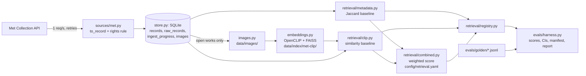
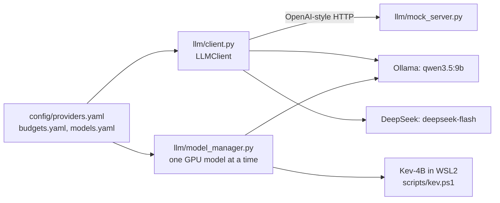

# Architecture (as built, 12 October 2026)

What exists in `src/refdesk/`, how the parts connect, and what comes next. The design intent is in `docs/prd.md` (Section 10); decisions are in `docs/adr/`. This page describes the code as it is.

## Data and retrieval path

| Module | What it does | What breaks without it |
|---|---|---|
| `schema.py` | `ArtworkRecord` and `RightsRecord`. "Open" only with a structured flag; unknown rights are "Unverified"; descriptive fields stay empty rather than invented. | An adapter bug could store an open status with nothing behind it. |
| `wording.py` | Every fixed status label (rights, attribution, stop banners) in one file. | Labels drift between API, UI and reports. |
| `sources/met.py` | Met adapter: maps a raw object, applies the rights rule (`isPublicDomain`), polite client (throttle, backoff, image host allow-list, URL encoding). | No data; or images fetched from arbitrary URLs in museum data. |
| `store.py` | SQLite: records (upsert), raw responses, ingest progress (including skips), image cache index. Record, raw and progress written in one transaction. | No resume; duplicates; facts not traceable to the raw response. |
| `ingest.py` | Resumable, idempotent ingest; `rebuild` re-derives records from stored raw responses with no network. | A mapping fix would need a full re-fetch. |
| `images.py` | Caches images for open works only, atomically, with sha256. | No image embeddings; risk of fetching non-open images. |
| `embeddings.py` | FAISS exact index over normalised CLIP vectors; manifest skips unchanged rebuilds; VRAM check before loading. | No similarity retrieval. |
| `retrieval/` | `Query`, `Hit`, `Retriever` protocol; rights filter `allowed()` shared by every retriever; Jaccard and CLIP retrievers; registry with lazy resources. | Retrievers would diverge on rights and avoid lists. |
| `retrieval/combined.py` | FR-3 score: `w_similarity x cosine + w_attributes x jaccard`, each hit's two terms in `Hit.components` (they sum to the score). Conditions boost or filter per field; records without an image vector rank on attributes alone. Weights in `config/retrieval.yaml` feed the eval config hash. | No search that uses both conditions and similarity; no per-hit explanation of a mixed score. |
| `evals/` | Golden-case format and validator, rule engine (golden-v0), scorers, bootstrap CIs, harness, paired comparison, judge probe. | No measured claims. |

## Model path

- **`LLMClient`**: one client for every provider. Before any request it checks keep-local, model and price present, key, budget, approval, and the worst-case cost against the remaining budget. Every failure is a hard error with no fallback. It retries 429, 5xx and timeouts against the same provider, refuses empty answers, and records the model each response reports.
- **`ModelManager`**: unloads every other model, checks free VRAM against the measured need in `config/models.yaml`, loads, and logs the load time.
- **Mock server**: deterministic answers with scripted failures (latency, 429, 500, timeout), used by tests and the M5 drills.

### Rationales (M3)

- **`rationale.py`** (issue #94, ADR-022): a rationale is JSON, a list of claims (`field`, `value`, `text`) plus a separate `fit` sentence. `parse_rationale` rejects non-JSON, missing fit, and any claim on a field records do not have or this record leaves empty. Claims may rest on title, artist, date, date_begin, date_end, medium, classification and subject_tags; never on rights, which come only from the rights record.
- **Prompts** are versioned files in `src/refdesk/prompts/` (`rationale-v1.md`) with a changelog line per version. `load_prompt` returns the text and its SHA-256, which goes into `EvalConfig.prompt_hashes`, so a prompt change changes the config hash.
- **Mock server** answers rationale prompts with claims built from the record block, and can be scripted to return `malformed`, `nofit` or `badfield` answers.
- **`generator.py`** (issue #95): `generate_rationale` calls `LLMClient` for one record and the brief, retries an unusable answer once, then returns it as failed with the reason (the item becomes "Needs human check"). Keep-local, budget and approval refusals stay hard errors. It records tier, provider, family, requested and reported model, tokens, cost summed over attempts, and the prompt's name and hash.
- **`verifier.py`, stage 1** (issue #96): plain-code checks of each claim's value against the record (normalised equality; a date inside the record's years; a subject among its tags). Attribution is checked in the claim's text too, so "by X" for "Workshop of X" fails before any model. Item checks: the record gives an attribution, and rights come from a structured source field. `item_status` is "Attribution verified from record" only when code checks and the judge (stage 2) both pass; otherwise "Needs human check".
- **`judge.py`, stage 2** (issue #97): `phi4` (tier `judge-phi4`, provider `ollama-microsoft`, family microsoft) judges each claim's text with `prompts/judge-v1.md` (the probed wording) and the fit sentence with `prompts/fit-v1.md`, one statement at a time, temperature 0. A same-family judge is refused before any request. A malformed answer gets one retry, then counts as a fail. `scripts/smoke_judge.py` runs it against local Ollama (manual).

## API

`api/app.py` is a FastAPI skeleton with the full contract from PRD 13A (`docs/api/openapi.json`, generated from code and checked by a drift test). `POST /boards` and `GET /runs/{id}` work for retrieval-only runs (`boards.py`, issue #45). Every other endpoint except `/healthz` returns 501 until implemented.

A board runs the retriever named in `config/retrieval.yaml` (`api.retriever`, default `combined`) as a background task after `POST` returns 202, so `GET` shows `retrieve` and then `done` or `stopped`. Each item carries evidence: record fields with the record's own values, such as `medium: Oil on canvas`, never normalised tokens. It also carries `score` and `score_components`. With `api.reasoning` set (issue #98; default: the mock generator and mock judge), each run then generates a rationale per item, checks it in code and has the judge check it (`reasoning.py`), phase by phase (state `generate`, then `verify`), with a per-run LLM client whose budget is the board's cap: G1 shows the spend and blocks when the next call could exceed the cap; G2 passes only when every item is verified. `sent_to` and `models_used` record where the brief went and which models answered. Retrieval-only runs (no `api.reasoning`, or `REFDESK_GENERATOR_TIER=none`) keep every attribution at "Needs human check", G0 and G2 skipped, cost 0 and `sent_to` empty. If the retriever cannot load, the run stops with "source unavailable", and `stop_detail` says what is missing; there is no fallback. Runs live in a `runs` table in the store, with one connection per call because the background task runs on another thread. `novelty` is accepted but not applied yet. Gate rules already enforced by the models: approval needs an explicit acknowledgement, keeping a flagged item needs a note, and approve/export are tagged `gates` so MCP can never expose them.

## UI

`ui/` is a Vite + React + TypeScript app (issue #41). `npm run build` writes `ui/dist`, which the API serves at `/` (one service, ADR-017). It is mounted after every API route, so API paths win, and it is not in the OpenAPI spec, so MCP can never expose it. Without a build, `/` answers 503 `ui_not_built` with the build command. The API checks for the build once at startup, so restart it after the first build. `REFDESK_UI_DIST` overrides the path. In dev, `npm run dev` proxies API paths to `uvicorn refdesk.api.app:app` on port 8000. The scaffold only shows whether the API is reachable; tokens, components and screens come in #42 to #46. CI builds and type-checks it in a separate `ui` job.

Design tokens and fixed wording are generated, never hand-written (issue #42): `scripts/generate_ui.py` (via `ui_codegen.py`) writes `ui/src/generated/tokens.css` from `design/tokens.json` (both themes; dark follows the system unless `data-theme` forces one) and `ui/src/generated/wording.ts` from `wording.py`. Tests check the documented contrast pairs (text 4.5:1, borders and focus 3:1, and the exact ratios stated in `tokens.json`), fail when a committed generated file is stale, and fail on any hex colour in `ui/src` outside `generated/`.

The 8 components from `design/components/` live in `ui/src/components/` (issue #43), each with its spec rules as tests (`npm test`, Vitest in jsdom). The safety rules sit in the components, so no screen can skip them. StatusBadge maps an inferred or unrecognised status to the cautious label. EvidenceCard shows an image only for works the source states are open with a structured flag, and drops non-http(s) URLs from museum data. GateStepper shows a missing gate as pending. StopBanner shows an unknown reason code instead of hiding it. ConfirmDialog keeps the forward action disabled, with its reason, until the acknowledgement and approver are given, and traps focus. A Button can only be disabled by giving a reason.

`/design/` (issue #44) is a second Vite page (`ui/design/index.html`) that shows every component in every documented state, using sample data that is marked as invented. A theme switch sets `data-theme`. `npm run test:e2e` runs axe on it in headless Chromium (Playwright), in both themes and with the approval dialog open. CI fails on any serious or critical violation. Reduced motion is on during the check, so colours are measured at rest, not mid-transition.

The board screens (issue #46) are S1 New board (`screens/NewBoard.tsx`) and S2/S3 (`screens/RunScreen.tsx`). The run screen polls `GET /runs/{id}`, showing the state in words while the run works and the board when it ends. It shows the brief, the mode, whether the brief stays on this machine, where it was sent, the cost, the gates, the stop banner with its detail, and every card with both badges, evidence and its score breakdown. The run ID is in the URL (`?run=`), so there is no router library. "More like this" starts a new board anchored on that work. The browser tests (`ui/e2e/`, `npm run test:e2e`) start the real API with uvicorn over a store built offline from the Met fixtures (`scripts/make_e2e_store.py`), with `REFDESK_RETRIEVER=jaccard` because CI cannot load CLIP. They block museum image requests so they stay offline.

## Commands

All via `uv run python -m refdesk <command>` (PowerShell or WSL2):

| Command | Does |
|---|---|
| `ingest met [--refresh] [--recheck-skipped] [--limit N]` | Resumable ingest of the Met paintings slice |
| `rebuild met` | Re-derive records from stored raw responses (no network) |
| `images met` | Cache images of open works |
| `embed met [--model] [--pretrained]` | Build the FAISS index (needs `uv sync --extra embed`) |
| `eval [--retriever jaccard\|clip\|combined] [--k 12]` | Run a retriever on a golden set; write manifest, report, history |
| `compare HASH_A HASH_B` | Paired comparison of two eval runs |
| `stats` | Record counts by rights status and ingest progress |

Also: `uv run python -m refdesk.llm.mock_server`, `scripts/judge_probe.py`, `scripts/build_golden_v0.py`, `scripts/record_met_fixtures.py`, `scripts/export_openapi.py`, `scripts/verify.py`, `scripts/run-loop.ps1`, `scripts/kev.ps1`.

## Not built yet

- Combined score of conditions and similarity (#34), the comparison report (#37).
- API endpoints beyond the skeleton (#45); UI tokens, components, design library and screens (#42 to #46).
- M3: rationales as structured claims, the verifier (code checks, then phi4 per claim and on the fit sentence), provenance pack, golden-v1.
- M4: routing labels, Kev-4B fine-tune and calibration, the loop controller, MCP server.
- M5: Docker, kind, drills, LangGraph port, bake-off.
