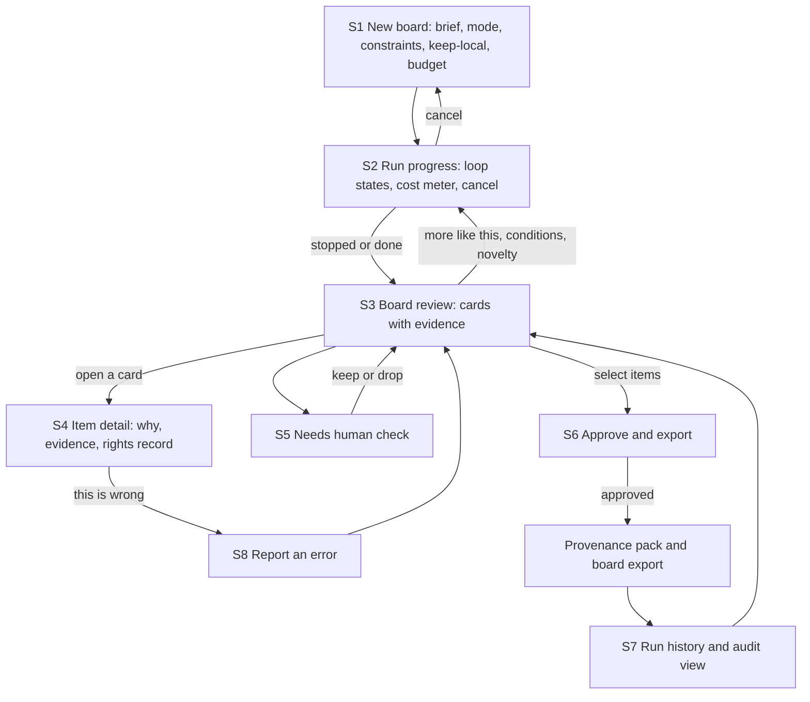
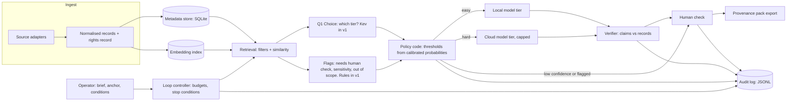
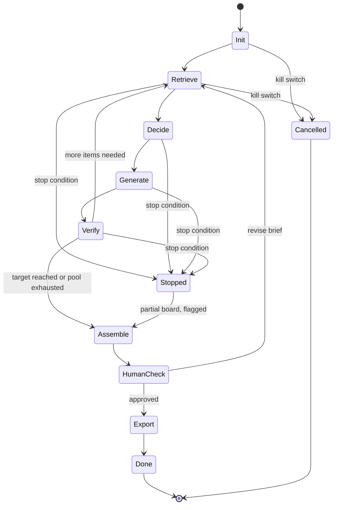

# PRD: refdesk (working title)

A rights-checked, explained art-reference workflow for small creative studios.

- Status: draft v0.3, 12 October 2026 (M1 done, M2 in progress)
- Owner: Joe Chung
- Audience for this file: Claude Code (as the working spec), and humans reviewing the project
- Companion files: `CLAUDE.md`, `docs/adr/`, `.claude/skills/`
- Learning objectives live in a separate tracker (milestones and tiers are in Section 17). This PRD does not repeat them.
- Work items live in GitHub Issues on `sycrus/refdesk` (see `docs/agents/issue-tracker.md`). This PRD is the single source of truth for scope; the root `PRD.md` was removed.
- Revision log: v0.2 (2026-10-11) applied the planning grilling decisions; v0.3 (2026-10-12) records the decisions since. See Section 23.

---

## 1. Summary

Given a creative brief, refdesk finds public-domain paintings from open museum collections that fit the brief, explains why each fits in the brief's own terms, and records for each image where it came from, what rights flag the museum gives it, and when that was checked. It runs local-first to keep cost near zero and uses a cloud model only for hard cases under a spend cap.

The project has two purposes that must be judged separately (Section 3):

1. A **product hypothesis**: this workflow is better than the alternatives for a specific user.
2. A **demonstration goal**: building it shows I can design, evaluate, govern and run an AI system.

If the product hypothesis fails, the project can still succeed as a demonstration. Public claims must match which one was earned.

## 1A. Design principles

1. **Explainability takes precedence.** When a choice trades explainability against convenience or a small accuracy gain, choose what the operator and I can explain, unless an ADR justifies otherwise. In practice: a hand-written loop before a framework, structured filters before opaque embeddings, rationales built only from records, calibrated probabilities with evidence, and Tree SHAP only where it applies.
2. **Evidence over claims.** Every displayed fact traces to a record. Every public claim traces to a measurement.
3. **Rights come from records, never inference.**
4. **Simple baselines first.** A complex method must beat the simple one on validation data and human ratings.
5. **Local-first and cost-bounded.** The mock server is the default, and spend has a hard cap.

## 2. Positioning and prior art

Retrieval of public-domain art is a crowded area. Do not compete on retrieval.

| Prior art | What it does | Notes |
|---|---|---|
| Cosmos / Public.Work | Curated mood boards for creatives; visual search over 100k+ public-domain images | Closest competitor |
| Rawpixel | Searchable CC0 collection plus design assets | Stock and design business |
| Google Arts & Culture, Art Palette | Search artworks by colour palette across 1,500+ institutions | Free experiment (2018) |
| ArtLens (open source) | OpenCLIP reverse image search over about 100k CC0 works from three museums | Reuse as baseline and possible backend |
| Artsy | Art Genome taxonomy, similarity and collaborative filtering, marketplace | Sales-oriented, different market |
| Academic recommenders | Content-based and knowledge-graph recommenders for art and heritage | Includes a 2026 ACM JOCCH paper on knowledge-graph heritage recommendation |
| General assistant with search | Can reason about a brief and suggest works | Must be a baseline, see Section 11 |

What I will not claim: a better art finder, novel retrieval, or authentication of any work.

## 3. Two kinds of claims

### Part A: Product hypotheses

Each hypothesis has a test and a falsification criterion. They are hypotheses until tested.

| ID | Hypothesis | Test | Falsified if |
|---|---|---|---|
| H1 | Brief-to-reference reasoning with a stated "why" helps art directors defend choices | Blind ratings of boards with and without rationales; interviews | Raters do not prefer rationales, or rationale errors outweigh the benefit |
| H2 | A per-object rights record has value to studios | Interviews and a pilot: do they ask for it, use it, or pay for it | Fewer than 3 of 8-10 interviewees describe a recent rights problem or use for the record |
| H3 | Verified attribution (from museum records, with "needs human check" for the rest) reduces errors versus a general assistant | Count attribution errors against museum records on the same briefs | Assistant baseline error rate is not meaningfully higher |
| H4 | A novelty control gives fresher references than baselines | Blind non-obviousness ratings, plus a popularity measure | No rating advantage over the best baseline |
| H5 | Local-first routing keeps cost per board low at equal quality | Cost per resolved board by tier, quality held constant | Routing does not beat always-cloud on cost at equal ratings |

Decision rule: if the system does not win on at least one dimension users care about (usefulness or non-obviousness) against the best baseline, present the project as a demonstration case study, not a product.

### Part B: Demonstration goals

Each maps to phases in the learning-objectives tracker.

| ID | Goal | Evidence (artifacts) | Tracker phases |
|---|---|---|---|
| D1 | Define correctness and build trustworthy evals | Golden set, error taxonomy, eval reports with confidence intervals | 0, 1 |
| D2 | Version everything and reproduce results | Run manifests, prompt files, config hashes | 2 |
| D3 | CI that gates on evals | PR and nightly workflows, gate policy | 3 |
| D4 | Containerise, deploy and operate | Dockerfile, k8s manifests, failure drills, postmortems | 4, 5, 6, 18 |
| D5 | Fine-tune a small decision model and calibrate it | Model card, baselines table, calibration report | 8 |
| D6 | Route by cost with measured quality | Router baselines, cost per board report | 15 |
| D7 | Bounded agent loop with governance | Loop spec (Section 10.2), audit log, threat model, control map | 9, 12 |
| D8 | Retrieval quality, measured | Retrieval ablations, bake-off ratings | 17 |
| D9 | MCP tools on top of the API, observability. Optional: ontology | Tool specs, dashboards, ontology | 13, 16, 20 |
| D10 | Use an agent framework with judgment, through an evaluated port | Framework port, comparison report, ADR-016 | 9, 11 |

## 4. Users and roles

These are hypotheses to validate in 8-10 interviews before building past milestone M1.

| Role | Who | Needs |
|---|---|---|
| Operator | Art director or freelance creative | References that are not obvious, with reasons they can defend |
| Approver | Producer or studio lead | A record they can sign off on and be blamed for |
| Reviewer | Client or brand owner | Plain-language evidence, no technical controls |
| Reader | Recruiter or employer | A worked example, eval report, ADRs, honest limits |

Primary segment to test first: small creative studios and freelance art directors. Test SME brands (packaging, seasonal campaigns, print) as payer. My own freelance practice is customer zero.

Buyer is unknown. The service (outcomes sold to clients) comes before software (a product sold to users).

## 5. Jobs to be done

1. Given this brief, show me about a dozen references that are not the obvious ones, with reasons.
2. For any I might reuse, tell me whether I can, and give me the credit line and file.
3. Tell me what you are unsure about.
4. Keep my costs predictable.

Usage modes (the user chooses, and it changes which checks run):
- **Reference only**: inspiration, no reproduction.
- **Reproduction**: the image may be reused. Requires a rights basis, credit line and resolution check.

Rights differ by country and by museum. The tool records what the museum states and never gives legal advice.

## 6. Scope

### In scope for v1
- Three open collections with machine-readable rights flags (Met, Art Institute of Chicago, Cleveland), starting with a paintings slice.
- Brief input with optional constraints and an avoid list.
- Anchor-plus-conditions search (pick a work, add conditions such as period, material, motif, department).
- Evidence on every result: record link, rights basis, why it matched, confidence, attribution-verified flag.
- Approve-and-export provenance pack.
- Budget cap with a live cost meter.
- A "this is wrong" report that feeds the golden set after human review.

### Non-goals
- Generating images.
- Authenticating or valuing artworks.
- Selling art or matching buyers to galleries (parked, see Section 16).
- Scraping or reusing images from any collection whose terms do not allow it, including Singapore national collections (permission required).
- Replacing the art director.
- Personal data about collectors or visitors.

## 7. Functional requirements

| ID | Requirement |
|---|---|
| FR-1 | Ingest records from each source adapter into one normalised schema (id, source, title, artist, date, medium, classification, subject tags, image URL, rights {flag, field, licence string, checked_at}, raw record reference). |
| FR-2 | Never store or display a rights basis that is not read from a structured source field. Unknown means "unverified". |
| FR-3 | Search by brief text, by anchor work, and by conditions. Combine structured filters and embedding similarity in one weighted score. |
| FR-4 | Provide baselines behind the same interface: metadata-only, off-the-shelf visual similarity, and a general assistant with search. |
| FR-5 | Generate rationales only from retrieved records. The model must not introduce facts (dates, attributions, provenance) from its own memory. A verifier checks each factual claim in a rationale against the record. |
| FR-6 | Mark any item whose attribution is inferred or unverifiable as "needs human check". |
| FR-7 | Route each request through a decision step. In v1 Kev answers one question (tier choice) and other flags start as plain rules. Questions are independent, so dependent logic lives in policy code or chained calls. A confidence cascade and LightGBM are baselines. See Section 10.1. |
| FR-8 | Enforce per-run budgets and stop conditions as specified in Section 10.2. |
| FR-9 | Require approval before export. Log every run and decision to an append-only audit log. |
| FR-10 | Export a provenance pack (CSV or PDF) listing each item, its rights basis, source, run ID and model versions. |
| FR-11 | Allow "keep this brief local" so it is never sent to a cloud model. |
| FR-12 | Build the API first, then an MCP server on top of it. The MCP server is a separate process that calls the API, so no business logic is duplicated. Read-only tools only (draft: `search_references`, `get_record`, `get_rights_record`, `get_run`). Approval and export are never exposed through MCP. Per-client credentials and scopes, contract tests, and an Inspector transcript. Tool results contain museum text, which is untrusted input. |
| FR-13 | Provide a web UI, served as static assets by the API, covering the flow in Section 8A. The UI shows evidence, rights status and cost on every result, and never hides a stop reason. |

## 8. Controls exposed to the operator

Keep labels in plain language. Do not expose model names, temperature, raw prompts or diversity parameters on the main screen.

| Control | Detail |
|---|---|
| Brief | Text or upload, plus optional mood, palette, era, region, subject |
| Avoid list | Clichés and overused works to exclude |
| Usage mode | Reference only, or reproduction |
| Anchor plus conditions | Pick a work, add conditions such as period, material, motif, department |
| "How far from the obvious?" | One slider, from familiar to unexpected |
| Sources | Toggle collections, date range, result count (can wait until after v1) |
| Confidence threshold | Show only reliable items; the rest go to "needs human check" |
| Speed or thoroughness | Fast draft or thorough; local only or allow cloud for hard cases |
| Budget cap | Per board, with a live meter and an escalation log |
| Approve and export | Approval step, then provenance pack |
| This is wrong | Report an error for review |

Model and adapter versions appear in the export and audit view only.

## 8A. UI and user flow (draft)

Section 8 lists the controls. This section says where they live and how an operator moves through them. Explainability takes precedence (Section 1A): the UI must show why, from what, and at what cost.

### Approach

- A React and TypeScript app (my strongest stack), built to static files and served by the FastAPI service. No extra service to deploy (ADR-017, decided). HTMX was considered and not chosen.
- Polish sells: the UI is also a portfolio asset, so it gets a real design system (`design/`) and careful states. It stays time-boxed because the learning goals are elsewhere. Polish here means clarity, consistency and honest states, not decoration.
- v1 is single-user and local. No accounts. Roles are views, not logins.

Screen designs for S1 to S6 are on the "refdesk: approval gates and screens" canvas.

### User flow



### Screens

| ID | Screen | Purpose | Key content |
|---|---|---|---|
| S1 | New board | Capture the brief and constraints | Brief text or upload, avoid list, usage mode, anchor and conditions, novelty slider, keep-local toggle, budget cap |
| S2 | Run progress (two states) | Make the loop visible | Running: current loop state, items appearing as accepted with skeletons for the rest, cost meter, cancel (kill switch). Stopped at the cap: a "Stopped: budget cap reached" banner with the counts and "Nothing was exported", the full cost meter, and two actions: raise the cap (an explicit decision recorded with name and time) or keep the partial board. A raised cap resumes from the checkpoint |
| S3 | Board review (main screen) | Review references | Card grid, filters (verified only), "more like this", conditions, novelty re-run, selection |
| S4 | Item detail | Explain one result | Why it fits with evidence chips linked to record fields, full record link, rights record, credit line, confidence, tier used |
| S5 | Needs human check | Handle uncertainty | Items with reasons (unverified attribution, low confidence, flagged), keep or drop |
| S6 | Approve and export | The irreversible step | Summary of counts and rights statuses, unverified items excluded unless I mark them reviewed, not-legal-advice note, export provenance pack and board |
| S7 | Run history and audit | Show the work | Runs list, event timeline per run, versions and config hash, re-run |
| S8 | Report an error | Feed the golden set | Error type (attribution, rights, irrelevant, rationale), note, queued for my review |
| S9 | Settings | Defaults | Budget caps, sources, local-only, per-provider switches for sending real briefs to each cloud provider (off by default) |
| /design | Design library | Show every component in every state, both themes | All 8 components from `design/`, built before the screens. Published with the static build. axe check in CI |

### Wireframe: S3 Board review

```
+------------------------------------------------------------------------------+
| refdesk   [New board] [History] [Settings]           Cost: 0.012 / 0.05 (cap)  |
+------------------------------------------------------------------------------+
| Brief: "Mid-Autumn tin, festive but not red and gold"                          |
| Mode: Reproduction   Stays on this machine: yes                               |
| Conditions: [period v] [material v] [motif v]                                  |
| Novelty:  familiar ----o---- unexpected          Show: (x) all ( ) verified    |
| Status: Done, 12 of 12 accepted                                                |
+------------------------------------------------------------------------------+
| +-----------+ +-----------+ +-----------+ +-----------+                        |
| |  image    | |  image    | |  image    | |  image    |   (grid continues)     |
| | Title     | | Title     | | Title     | | Title     |                        |
| | Artist,   | | Artist,   | | Artist,   | | Artist,   |                        |
| | date      | | date      | | date      | | date      |                        |
| | Why: ...  | | Why: ...  | | Why: ...  | | Why: ...  |                        |
| | [Attribution verified]  [Rights: open as stated by source]                   |
| | More like this | Report | [ ] Keep                                           |
| +-----------+ +-----------+ +-----------+ +-----------+                        |
+------------------------------------------------------------------------------+
| Needs human check (2) >                    [Approve 7 selected and export]    |
+------------------------------------------------------------------------------+
```

### Explainability in the UI

- Every card shows why it fits, with the matching constraint or record field highlighted.
- Attribution and rights are separate badges with fixed wording: attribution "verified from record" or "needs human check"; rights "open (as stated by source)", "unverified" or "permission required".
- Confidence is shown as a plain bucket (high, medium, low) with the calibrated value on hover.
- Cost and tier used are visible per run and per item. Model and adapter versions appear in the audit view only.
- A stop reason is never hidden. A partial board says why it is partial.
- A "this brief stays on this machine" indicator is always visible when keep-local is on.

### Roles as views

| Role | v1 view |
|---|---|
| Operator | S1 to S5, S7, S8 |
| Approver | S6 (same person in v1) |
| Reviewer (client) | A read-only export (static HTML or PDF) with evidence in plain language. No controls |
| Reader | A public case-study page and screenshots, not the live app |

### States and errors

| Situation | UI behaviour |
|---|---|
| No results | Say which condition removed them and offer to relax it |
| Budget cap or step cap reached | Show the partial board, the stop reason and the cost |
| Source unavailable | Name the source, continue with others, flag the gap |
| Unverified attribution | Show as "needs human check", never as verified |
| Cloud tier needed but brief is keep-local | Stay local and say so, or ask to change the setting |
| Run killed | Confirm nothing was exported |
| Rate limit | Show a retry state, not a blank screen |

### Not in v1

Image editing, a free-form mood-board canvas (Cosmos and Pinterest do this well), real-time collaboration, accounts, and mobile authoring. Mobile is for reading a shared board only.

### Accessibility and content

Desktop-first with a usable tablet layout. Keyboard navigation for the card grid, visible focus, alt text from title and artist, sufficient contrast, plain language labels. Image-heavy views must not rely on colour alone to show status.

## 8B. Approval gates and the UI they expose (draft)

A run passes through gates. Some are automatic, some need a person. The UI shows every gate in one stepper and exposes a different surface at each. Visual reference: the "refdesk: approval gates and screens" canvas (gate map and screens S3, S5, S6) and the "refdesk design system".

| Gate | Who | Trigger | UI surface | Components | If it does not pass | Recorded |
|---|---|---|---|---|---|---|
| G0 Intake | Automatic | Brief submitted | S1 New board, inline checks | Input, StopBanner | Request declined, with the reason and alternatives | Decision, reason code |
| G1 Spend | Automatic; you at the cap | Before each model call | S2 Run progress, cost meter | CostMeter, StopBanner, Button | Stopped: budget cap reached. Raise the cap (explicit) or keep the partial board | Spend, cap, reason code, who raised the cap |
| G2 Verify | Automatic, per item | After each rationale | S3 Board review, two badges on every card | StatusBadge, EvidenceCard | "Needs human check" with the reason. Never shown as verified | Result per item |
| G3 Review | You (operator) | Flagged items exist | S5 Needs human check | EvidenceCard, Button, note field | Flagged items stay out of the pack. Continue stays disabled until each is decided | Decision, note, who, when |
| G4 Approve | You (approver) | Board ready | S6 Approve, summary and dialog | ConfirmDialog | Approve stays disabled until the acknowledgement is ticked and a name entered | Approver, acknowledgement, time |
| G5 Export | You, irreversible | After approval | S6 Receipt | ConfirmDialog, AuditTimeline | No export without an approval record. A failed export leaves the board unlocked | Export file, run ID, versions. Board becomes read-only |
| G6 Client sign-off | Later | Shared link | Read-only page | not in v1 | not in v1 | not in v1 |

Rules:
1. **The API enforces gates. The UI only reflects them.** A client that skips a screen still cannot export.
2. All gates are always visible, in order, with states: passed, active, pending, blocked, skipped. A gate is never shown as passed until the action it needs has happened.
3. Human gates name who must act. In v1 the operator and approver are the same person, but G4 is a separate step so there is a deliberate pause.
4. "Approve and export" is one button but two recorded steps: approval (G4), then export (G5).
5. Forward navigation is blocked until a gate passes. Backward navigation is allowed until export. After export the board is read-only, and a change creates a new version.
6. A blocked gate always says why, in words, in a StopBanner.
7. Every gate decision is written to the audit log with the run ID, actor, time and reason code.

## 8C. Design system

A generic, reusable system lives in `design/` (tokens, brand book, component specs). It is editorial and restrained: warm paper surfaces, hairline rules, one verdigris accent, a serif for artwork titles.

- **Tokens:** `design/tokens.json`. Implement as CSS custom properties. Light and dark themes. Text 4.5:1 and control borders and focus rings 3:1, checked for the token pairs.
- **Type:** Newsreader (display and artwork titles), Inter (interface), JetBrains Mono (IDs, hashes, record fields).
- **Components:** Button, StatusBadge, EvidenceCard, GateStepper, CostMeter, StopBanner, ConfirmDialog, AuditTimeline. Specs in `design/components/`.
- **Fixed wording** for statuses lives in one constants file, and is never paraphrased.
- **State is never colour alone:** every state colour pairs with an icon and a label.
- **Never** show an inferred attribution or rights status as verified.
- **Motion** is short and quiet (120 to 200 ms), and respects reduced-motion.
- When a built component and its spec disagree, fix the app or change the spec and say why.

## 9. Data sources and rights policy

Maintain `docs/data-sources.md` (licence, API or dump, rights field, rate limits, date checked, known drift).

| Source | Notes (confirm against live responses before relying on them) |
|---|---|
| The Met | Open-access API with public-domain flag and CC0 image URLs for flagged objects. Be polite: stay well under the stated request cap. |
| Art Institute of Chicago | Public API, CC0 metadata, public-domain flag, IIIF images. |
| Cleveland Museum of Art | CC0 open access. Documentation has been reported to say "Open Access" for the licence field while the API returns "CC0". Write a contract test for this kind of drift. |
| Others (Rijksmuseum, Smithsonian and so on) | Add only after reading terms and confirming a machine-readable rights flag. |
| Singapore collections (National Gallery Singapore via Roots.sg, National Archives) | Treated as permission required. Terms ask for written permission stating use, timeframe and identity. Do not scrape. Record as "not open, date checked". A request to the institution is a possible partnership, not a data source. |

Rules:
- Use only objects whose structured rights flag says public domain or CC0.
- Record `{source, object_id, flag_field, flag_value, licence_string, checked_at}` for every item.
- Do not infer public-domain status from an artist's death date or from memory.
- Store links and embeddings. Download images only where the licence allows, and cache politely.
- Add a not-legal-advice note to every export.

## 10. Architecture



Tiers:
1. **Mock LLM server** (`refdesk.llm.mock_server`, built): deterministic answers, configurable latency, scripted 429, 500 and timeout responses, changeable at runtime. Default for tests, infrastructure drills and CI.
2. **Local model** (Ollama): `qwen3.5:9b` (ADR-020; 7.6 GB, thinking off). Kept as a routing tier only if its rationales meet the M3 quality bar.
3. **Capped cloud model**: `deepseek-flash` (ADR-020), with `deepseek-v4-pro` as a reserve tier. Spend cap enforced in the client and router. GLM is not used: the Coding Plan's usage policy limits it to supported coding tools.

The routing tiers are a **config list**, not code. Start with `[local-small, cloud-flash]`. If the local tier fails the end-to-end quality bar, switch to `[cloud-flash, cloud-strong]` and record it in ADR-020. The router and the labelling pipeline read the options from config. Every tier pins a dated model ID, never an alias.

**Providers and data flow.** Each provider in config has a `family` tag (`deepseek`, `qwen-local`, and for judges `ibm`, `microsoft`). `keep_local` blocks every cloud provider. Both cloud providers are based in China, so the per-provider switches below are the control for client data. Where a provider only offers alias model names (DeepSeek's `deepseek-flash` and `deepseek-v4-pro`, checked 2026-10-11; retired names are silently served by newer models), record the `model` field from every response in the run manifest, so a silent upgrade shows up as a version change. Sending real operator briefs to a cloud provider needs that provider's switch in S9, off by default. The UI and audit log show where each brief was sent.

**Paid calls.** Three layers, all required: a key in `.env` (the user fills it in), a per-job budget in `config/budgets.yaml`, and a dry run that prints estimated calls, tokens and cost, followed by a run with `--approve` recorded in the run manifest. A blocked paid call is a hard error, never a silent fall back to the mock.

**GPU.** One GPU-heavy job at a time. Windows uses about 2.1 GB at idle, so about 14 GB is usable. Measured needs live in `config/models.yaml`: no local generator or judge fits next to Kev-4B (about 8.4 GB), so models are swapped **once per phase** (decide, generate, judge) by the `ModelManager` (`refdesk.llm.model_manager`, built), which unloads everything else, checks free VRAM against the measured need, and logs each load time as an event.

**Rationale verification (FR-5; ADR-021, ADR-022).** The generator returns structured claims, each naming the record field it comes from (the evidence chips in 8A), plus a separate sentence about fit. Field-value claims are checked by plain code; the rest are checked one claim at a time by `phi4`, which also checks that the fit sentence adds no fact absent from the record (ADR-022; Granite Guardian dropped 2026-10-27 after a harder probe). Any failure makes the item "Needs human check", naming the failing claim. Rationales are not split after the fact, because a splitting model can drop or merge the very claim that is wrong.

Components and decisions (see ADRs):
- Retrieval backend: OpenCLIP image embeddings (default `ViT-B-32/laion2b_s34b_b79k`; model choice is ADR-010) in an exact FAISS `IndexFlatIP`, kept as FAISS so an approximate index can replace it if the corpus grows. Images are cached for open works only. Retrievers share one interface and registry: the metadata-only Jaccard baseline and the CLIP similarity baseline exist; the combined score (FR-3) is next. Put effort into evidence and evals.
- Decision model: fine-tune Kev-4B (LoRA from the released `kev-4b@v1.0` checkpoint). Kev-0.8B is kept as a size ablation only, because its accuracy on unseen tasks (0.648 dev) is close to a rule. Compare against a confidence cascade and LightGBM on structured features. Kev runs in its own WSL2 clone (`~/kev`) and is called over HTTP.
- Tracing: Arize Phoenix locally. Evals are plain code (pytest), not in a platform.
- Memory: SQLite for state. Mem0 deferred.
- Governance model: taxonomy and typed schemas. A small ontology is optional (Tier 4).
- Deployment: Docker, kind for local Kubernetes, with a written note on when Cloud Run would be better.
- MCP: built after the API, on top of it (FR-12). A thin adapter that calls the API over HTTP. Decided (ADR-015).

### 10.1 Decision contract (draft, for me to define)

This is learning-critical. Claude Code may format and validate it but must not decide the meaning of a question or the cost of a wrong answer.

Facts about Kev that shape the design (confirm against its repository before relying on them):
- One call can carry several typed questions about the same input: yes/no (noul), choice (2-255 options) and score (2-255 ordered levels). Each returns a calibrated probability, with no generated text.
- Questions are evaluated independently and cannot see each other's answers. Conditional logic ("ask B only if A is yes") belongs in policy code or chained calls.
- The input is one block of text with a limited context window (8,192 tokens validated for the 4B model, confirmed in the Kev README on 2026-10-11). Do not pack long briefs without checking.
- Loading an adapter checkpoint briefly holds a second copy of the weights (Kev-4B peaked at 15.9 GB that way, against 8.4 GB for full bf16 weights, measured on MLX). Serve from pre-merged full weights, merged once on CPU.
- Kev's server has no unload endpoint. Unloading means stopping the process.

v1 starts with one Kev question. Every added question needs its own labels, golden set, calibration and a simple baseline.

| ID | Type | Draft wording | Options | Feeds | Cost of a wrong answer | v1 status |
|---|---|---|---|---|---|---|
| Q1 | Choice | Which tier should handle this request? | local, cloud | Routing | To define: cost of sending a hard brief to local; cost of sending an easy brief to cloud | Kev (fine-tuned on routing labels) |
| Q2 | Yes/no | Does this need a human check? | yes, no | "Needs human check" list | To define | Rule (confidence threshold) |
| Q3 | Yes/no | Does the brief involve a culturally sensitive symbol? | yes, no | Review flag | To define (high stakes; needs expert labels) | Rule (curated list) |
| Q4 | Score | How abstract or hard is this brief? | ordered levels | Input to Q1 or to LightGBM | To define | Not in v1 |
| Q5 | Yes/no | Is this a declined request (living-artist style, authentication)? | yes, no | Decline path | To define | Rule |

Rules for adding or changing a question:
1. Labelled data exists, or a plan to create it. For Q1 the labels are the routing-labels dataset (the cheapest tier that got each case right).
2. A simple rule has failed on named cases.
3. The cost of each kind of error is written down by me.
4. Every input to the decision is available before the decision is made.
5. A question is replaced by its simple baseline if it does not beat that baseline on validation data.

Policy code turns calibrated probabilities into an action. Thresholds come from validation data. Abstention (low confidence) escalates to the cloud tier or to a human, depending on the flag.

### 10.2 Loop specification (draft, for me to define)

The "loop controller" in the diagram is the part that decides what happens next, when to verify, when to resume and when to stop. This section specifies it. Numeric values are placeholders until measured. Learning-critical: stop conditions, risk tiers and thresholds are mine to define; Claude Code drafts and tests, it does not decide them.

**Design choice.** v1 is a fixed workflow with a bounded loop, not an open-ended autonomous agent. The controller is an explicit state machine in code. Models are called at set steps (decide, generate, judge if used). The model does not choose tools freely in v1. Add autonomy only where a measured need appears, and record it in an ADR.

**Loop goal and exit criterion.** Build a board of K accepted items (default K = 12, placeholder). An item is accepted only if the verifier passes it:
- a rights record exists, read from a structured source field (FR-2);
- the stated attribution matches the museum record, otherwise the item is marked "needs human check";
- each factual claim in the rationale matches a field in the record (FR-5).



**Stop conditions.** Each one must be testable and must stop the run before the next costly action.

| Stop | Rule (placeholder values) | Result |
|---|---|---|
| Success | K accepted items | Assemble |
| Step cap | At most 6 retrieval rounds | Stopped, partial board flagged |
| Budget cap | Money and token cap per board; check before each model call and stop before the call that would exceed it | Stopped, partial board flagged. The user may raise the cap explicitly (recorded) to resume from the checkpoint |
| Timeout | Wall-clock limit per run (120 s placeholder) | Stopped |
| Stuck | Same candidate set repeated, or no new accepted item in 2 consecutive rounds | Stopped |
| Pool exhausted | No candidates left that satisfy the conditions | Assemble with a message to relax conditions |
| Kill switch | User cancels | Cancelled, no export |
| Policy | A declined request (Q5) or a "keep local" brief that would need the cloud tier | Decline, or stay local |

**Escalation.** Low-confidence or flagged items go to the human check list. An item that fails verification twice is dropped and marked "needs human check".

**Checkpoint and resume.** Run state lives in SQLite. Each completed step writes a checkpoint and an event. Every step has an idempotency key (run ID, step, hash of inputs). Resume from the last completed step without repeating a model call or an export, using the key to reuse recorded results.

**Risk tiers for actions.**

| Tier | Actions | Rule |
|---|---|---|
| Read-only | Museum API search, record reads | Allowed, rate-limited |
| Reversible | Writing run state, caching | Allowed, logged |
| Irreversible | Exporting a provenance pack; sending a brief to a cloud model | Export requires approval. Cloud send is blocked when the brief is marked local |

**Run log.** Append-only `events.jsonl`, one event per step: run ID, step, state, tool, hash of arguments, result summary, tokens, cost, latency, model and adapter versions, decision probabilities, reason code. A failed run must be replayable from recorded tool outputs so a faulty step can be found.

**Minimal harness.** Only what the loop needs: a tool runner with timeouts and error handling, the SQLite state store, the structured log, a permission allow-list per tool, and a budget meter. Do not build a general agent framework.

**Acceptance scenarios (optional BDD, deterministic behaviour only).**
1. The run stops before a model call that would exceed the budget cap.
2. The run stops after two rounds with no new accepted item.
3. A killed run resumes without repeating a model call or an export.
4. A "keep local" brief never reaches the cloud tier.
5. Export is impossible without approval.
6. An item failing verification never appears as verified.

Do not write scenarios for answer quality. That is covered by evals and trajectory evals (reliability across repeated runs, pass^k, with recorded tool outputs).

### 10.3 Decision model training plan (draft)

Covers the Kev fine-tune for Q1 (tier choice). Learning-critical: the quality bar behind the labels and the cost of each error are mine to define.

- **Labels.** About 1,500 synthetic briefs, run through each configured tier. The label is the cheapest tier that met the quality bar: verifier pass plus an LLM judge. The judge is calibrated against my ratings on 100 sampled rows, and its agreement is reported before any label is trusted. **A model never judges its own family's output**: the judge is picked per row from a different `family` than the generator, startup fails if no valid judge exists, and both families are written to each label record. Judge (ADR-021, amended 2026-10-27): `phi4`, one claim at a time, local. Budget: `labelling_budget_usd: 20` (generation only; judging is local). Kev's own README found a 400-record fine-tune gain inside noise, so do not train on fewer than about 1,000 rows; 50 golden cases are far too few.
- **Split.** By source or time, not random rows. Check for near-duplicates across splits. The golden set stays held out.
- **Model.** Kev-4B, trained in WSL2. Try locally first (estimated 9-10 GB for short routing inputs; measure on the first run). Fall back to Modal under `training_budget_usd: 10`. Record base size, LoRA rank, seed and adapter hash for every run. If Kev does not beat LightGBM or the cascade, report that honestly.
- **Baselines on the same split.** Majority class, rules, zero-shot logits on a local model, confidence cascade, LightGBM on pre-decision features (token count, option count, top retrieval score, number of conditions, usage mode, avoid-list present), a hosted model if budget allows, and fine-tuned Kev.
- **Calibration.** Fit temperature scaling on validation data, not test. Report a reliability diagram, ECE, and coverage at a 5% error budget. Choose the abstention threshold from this.
- **Out of domain.** Hold out a whole source or brief type. Report the drop and name the failure modes. Unfamiliar inputs go to the human check.
- **Serve behind the contract.** The typed-question contract (choice, yes/no, score, with calibrated probabilities) is fixed; backends are adapters behind it. Kev-4B is the first; the cascade, LightGBM and other decision models that speak the contract (for example H2O-Lightning-4B) are interchangeable by changing a base URL (ADR-001). Log the backend and adapter hash with every decision.
- **Explanation.** Probabilities and the evidence used for Kev. Tree SHAP only for LightGBM.
- **Artifacts.** `docs/decision-contract.md`, `docs/model-card.md`, `reports/baselines.md`, `reports/calibration.md`.

### 10.4 Loop implementation plan (draft)

Explainability takes precedence (Section 1A), so the loop is built in two stages.

1. **Plain-code reference (M2 to M4).** An explicit state machine in Python that follows Section 10.2, with tests first. This version is the specification in executable form.
2. **Framework port (M5).** Reimplement the same state machine in LangGraph behind the same API interface. LangGraph is chosen for its persistence and interrupt features and my prior experience with it. Other frameworks were not evaluated.
   - Use its checkpointer for resume (SQLite) and `interrupt()` for the human approval step.
   - Implement stop conditions, budget caps and the verifier as explicit guards. A framework does not decide these.
   - Keep the run-log schema identical.
   - Pin the framework version.
3. **Comparison.** Run the same acceptance scenarios and trajectory evals (pass^k, step failure taxonomy) on both. Report code size, resume behaviour, trace readability, failure modes and debuggability. Record the outcome in ADR-016, including which version stays the default and why.

Rules:
- The port must pass the same acceptance scenarios and may not add autonomy beyond Section 10.2.
- The plain version is not deleted. It is the reference.
- The README stack section names the framework and its role honestly (used in a port, with a comparison).
- I must be able to explain what the framework does underneath (state persistence, resume, interrupts) before the port is accepted.

## 11. Evaluation plan

Evals are code in the repo. A golden set and a bake-off decide the product hypotheses.

1. **Golden set**: two kinds (ADR-018).
   - `golden-v0-synthetic`: generated in full by Claude Code, every case marked `provenance: synthetic`. Used only to build and test the harness, scorers and reports. Never used for H1-H4 claims or any published number.
   - `golden-v1` onwards: 40-50 cases. Claude Code drafts briefs and proposes expected references and grades; judges from other families check them; I label a blind subset first and review every label (ADR-018, amended 2026-10-26). Required before any eval number goes public.
   - Expected references come only from records actually ingested. Every case carries a `corpus_version` (v1 = the Met paintings slice), and reports never compare across corpus versions. Versions are frozen; changes create a new version.
2. **Metrics**: attribution error rate (against museum records), retrieval recall@k and MRR on labelled briefs, citation faithfulness (does the cited record support the claim), rationale factual accuracy, diversity or non-obviousness, cost per resolved board, latency.
3. **Confidence intervals** on everything (seeded percentile bootstrap). recall@k is **capped** (hits ÷ min(relevant, k)) until graded golden data exists. Compare two runs with a **paired** comparison over per-case differences (`refdesk compare`). Measure run-to-run noise. Set gate thresholds above noise in `docs/eval-gate-policy.md`; until then golden-v0 is a non-blocking tripwire.
4. **Judge calibration**: report agreement with human labels and test position bias (for any pairwise judging, run each pair in both orders, as in JudgeBench). A synthetic judge probe (60 items with one planted false fact each) screens candidate judges before human calibration (`evals/reports/judge-probe-*.md`).
5. **Bake-off** (20 briefs): the system versus a metadata-only baseline, an off-the-shelf similarity baseline (such as ArtLens), a well-prompted general assistant with search, and manual use of Cosmos Public.Work or Rawpixel. Three art directors rate blind on usefulness, non-obviousness and time to a usable board. Attribution errors and rights-record presence are counted separately.
6. **Honest reporting**: state where baselines won or tied. Do not use "has the queried attribute" as the quality metric, because it can hardly fail.
7. **Trajectory evals** (the loop, not just the answer). Classify failed runs by step (wrong retrieval, bad decision, rationale error, verification miss, bad stop). Run each brief k times and report the share where all k runs succeed, next to single-run success. Record tool outputs so runs replay deterministically with mocked tools. Keep a regression suite where a deliberately bad change fails CI.
8. **Trace-to-test loop.** A "this is wrong" report is reviewed by me, then added to the next golden-set version with a provenance field. Frozen versions are never edited. Keep one worked case study from a real bad answer to a verified fix.
9. **Usability test.** Three art directors do these tasks on the real UI, think-aloud: create a board from a brief; find an item's rights basis and credit line; correct a wrong item; approve and export. Record time, errors and where they hesitate. Report what they misread, especially the attribution and rights badges.

## 12. Cost and routing

- Cost is measured per resolved board, including retries and escalations, not per token.
- Baselines for the router: always-cloud, always-local, random, confidence cascade, zero-shot logits on a local model, LightGBM on structured features, fine-tuned Kev.
- Every routing feature must be available before the decision. A feature that needs the local model's answer makes it a cascade.
- Proposed starting cap: USD 0.05 per board (a placeholder; revise after measuring).
- Add a "does this need a model at all?" classification: no model, cache, rules, small model, local LLM, cloud LLM.

## 13. Governance and safety

- Threat model covering direct and indirect prompt injection (museum text fields are untrusted input), data exfiltration and excessive agency.
- Tools run with least privilege. Read-only by default.
- Approval before export. Append-only audit log with request ID, actor, action, approver and time.
- Injection test corpus runs in CI.
- Control map to Singapore's IMDA Model AI Governance Framework for Agentic AI and AI Verify, stating residual risk. This is a map, not a compliance claim.
- Explainability note: probabilities and evidence for Kev; Tree SHAP only for tree models (LightGBM).

## 13A. Operations, delivery and observability (draft)

Values are placeholders until measured. This is what the Tier 1-2 delivery work needs from the product.

**Service shape.** The API is built with FastAPI (ADR-014) and comes first. The MCP server is built afterwards as a separate process that calls the API (ADR-015). One deployable HTTP service plus the MCP adapter, a nightly eval job and the mock LLM service. A CLI is available for local development.

| Endpoint | Purpose |
|---|---|
| `POST /boards` | Start a run from a brief |
| `GET /runs/{id}` | Run state, items and events |
| `POST /runs/{id}/review` | Record G3 decisions on flagged items (keep with a note, or drop) |
| `POST /runs/{id}/cap` | Raise the spend cap (explicit, recorded with name and time) and resume from the checkpoint |
| `POST /runs/{id}/approve` | Record approval (G4): acknowledgement and approver name |
| `POST /runs/{id}/export` | Export the provenance pack (G5). Requires an approval record |
| `POST /reports` | "This is wrong" report |
| `GET /healthz` | Liveness |
| `GET /readyz` | Readiness. Fails when the metadata store, embedding index or required model backend is unavailable |

**Versioning.**
- Every run writes `runs/<hash>/manifest.json`: git SHA, prompt hashes, model identifier (digest or dated ID, never an alias), adapter hash, data and index versions, golden-set version, seed, parameters.
- Prompts are versioned files with a changelog line saying why each changed.
- `docs/reproduce.md` reproduces a past result with one command, tested at least once a week later.
- `CHANGELOG.md` entries link to the eval report that justified them.

**CI.** GitHub Actions, actions pinned by SHA (ADR-019). From M0 a PR job on `ubuntu-latest` runs pytest plus the frozen-golden and secret checks (`scripts/verify.py`, which runs the same on Windows and Linux). The nightly job (M4) and CD to kind (M5) use a self-hosted runner on the dev machine, which is acceptable only while the repo is private; remove it before the repo goes public. Two tiers. PR tier replays recorded responses and is fast and deterministic. Nightly tier calls a real model locally or from a self-hosted runner. Gate thresholds sit above measured noise and live in `docs/eval-gate-policy.md` with a flake policy. `results/history.csv` records score, interval, cost and wall-clock. Secrets come from the CI secret store and never appear in logs. Pin action versions.

**Containers.** Multi-stage build, non-root user, pinned dependencies, vulnerability scan with triage notes. Configuration comes from the environment, with `.env.example`. No secrets and no model weights in the image.

**Kubernetes (kind).** Deployment, Service, ConfigMap, Secret template, HPA, nightly eval CronJob, probes, resource requests and limits. The API holds run state in SQLite and the index in memory, so it is not freely scalable. Either run the API as a single replica and demonstrate HPA on stateless parts, or add a small database as another service. Decide and record it in ADR-009. Autoscale on concurrency or queue depth, not CPU alone, because the service waits on model calls. Failure drills, each with measured time to detect and time to recover, and a postmortem:
- kill a pod
- missing secret
- memory limit too low (OOM)
- bad image, then rollback
- provider 429s from the mock server
- readiness failing because the index is unavailable

Write an ADR comparing this workload on Kubernetes with Cloud Run, including what a local cluster hides.

**CD.** Images tagged with the git SHA. Deploy on merge through Kustomize overlays: dev (mock LLM) and prodlike (local model). Roll back by redeploying a prior SHA, timed. State when rollback is not enough (index or data changes).

**Observability.** Phoenix for local tracing, redacting before logging (briefs may be confidential). Golden signals: latency p50 and p95 per board by tier, error rate, saturation, cost per board, escalation rate. SLO proposals (placeholders): a stated percentage of boards complete within a time limit, an error-rate ceiling, and the cost cap. Every alert is tested by fault injection and has a runbook.

**Public proof (for the Reader role).** README with the results table, limits and which model produced them; a worked example; an eval report that includes failures; the ADRs; the bake-off write-up; the trace-to-test case study; the failure-drill postmortems.

## 14. Constraints

- Hardware: RTX 5080 with 16 GB VRAM (16,303 MiB reported; about 2.1 GB used by Windows at idle), 32 GB RAM, Windows 11. WSL2 Ubuntu-24.04 sees the GPU and gets 23 GB RAM and 8 cores. Kev training and serving run in WSL2; the API, UI and Ollama run natively on Windows. Kev-9B needs about 17 GB to serve, so it is out of scope locally. PyTorch needs CUDA 12.8+ for this GPU (compute capability 12.0); it is an optional `embed` extra so CI never installs it.
- Do not run everything at once: Ollama, kind, Docker Desktop and a tracing stack compete for 32 GB RAM.
- Windows: prefer a task runner that works natively (Python scripts or `just`) or WSL2. Do not assume `make`.
- Index build: the Met European Paintings slice is 2,588 records (2,308 open, 280 permission required); its 2,308 images embed in about 9 s on the GPU. That is smaller than the 10-20k first assumed. A full three-museum build has been reported to take 15-18 hours elsewhere.
- Cloud tokens are limited. Use the mock server by default.
- Singapore users: personal data, if ever stored, falls under local data protection law. v1 stores none.

## 15. Success metrics

Provisional. Confirm or replace after baselines exist.

| Metric | Target |
|---|---|
| Items flagged "verified" with a wrong attribution | 0 on the golden set |
| Exported items with a rights record from a structured flag | 100% |
| Attribution error rate vs general-assistant baseline | Reported with interval; hypothesis H3 holds only if lower |
| Retrieval recall@10 vs metadata-only baseline | Better by more than the 95% interval, or reported as a tie |
| Human ratings | Win on usefulness or non-obviousness against at least one baseline, or reposition as a demonstration |
| Median cost per board | At or below the cap, with escalation rate reported |
| Time to a usable board | Set after interviews |

## 16. Parked directions (with revisit triggers)

| Direction | Why parked | Revisit if |
|---|---|---|
| Gallery art-finder matching buyers | Different market, proprietary data, sales and compliance risk, strong incumbent (Artsy) | 3 gallery or museum marketing contacts describe a recurring paid need |
| Gallery and museum audience engagement (content series, education packs) | Different buyer | Same trigger, via interviews |
| Cultural signal triage and speculative futures (builds on the Cultural Signal Graph) | Needs a corpus and evals of its own | After v1 bake-off, if there is demand |
| Singapore and Southeast Asian collections | Permission required | An institution grants a dataset or partnership |
| Target country and jurisdiction notes | Rights come only from the museum's stated flag, so a country input would change nothing in v1 and suggest a check that never ran | A user asks for jurisdiction notes |
| Advertising activations and methods corpus | Case libraries are copyrighted or paywalled | A licensable source is found |
| Knowledge-graph embeddings (RotatE-style) | Plain metadata baselines went far in the paper's own evaluation | Human ratings show a gap the simple version cannot close |

## 17. Milestones

Day budgets are a rough guide (about 23 working days in total). When a box runs out, cut scope and record the cut in the milestone issue. Do not extend the box. The bar is **functional and demo-ready**: every milestone is built in full whatever the interviews say. Each ends with an ADR update and, where relevant, an eval report.

- **M0 Scope and sources (1 day)**: repo scaffold, PR-tier CI, data-source register, problem statement (with the "usable board" placeholder), interviews started (optional, alongside the build).
- **M1 Ingest and baselines (4 days)**: one adapter (the Met, paintings slice), normalised schema, SQLite ingest, metadata-only baseline, `golden-v0-synthetic`, eval harness and first report on v0, ADR drafts (guided), API contract (OpenAPI).
- **M2 Similarity and conditions (4 days)**: embedding index, anchor-plus-conditions, off-the-shelf similarity baseline, bake-off design; the LLM client interface and the mock server behind it; local-tier end-to-end test and `ModelManager`. Before any screen, build the tokens, the fixed-wording constants and **all 8 components** with the `/design` page; then UI vertical slice S1 to S3 against the API.
- **M3 Reasoning and verification (4 days)**: `golden-v1` (proposed by Claude Code, reviewed by me); rationales from records only, verifier, attribution and rights records, provenance pack; UI S4 to S6 (evidence, needs-human-check, approve and export).
- **M4 Routing and budgets (5 days)**: routing labels (synthetic briefs, cross-family judge, my 100 calibration ratings), Kev-4B fine-tune with a clean split, calibration, cascade and LightGBM baselines, budget enforcement, loop controls, and the MCP server on top of the API (read-only tools, scopes, contract tests); UI S2 cost meter and cancel, S7 audit view; nightly CI on the self-hosted runner.
- **M5 Operate and prove (5 days)**: Docker, CI gates, kind deployment, failure drills and postmortems, bake-off with art directors, write-ups (Section 13A), and the framework port with its comparison (Section 10.4); usability test with three art directors.

Tracker tiers: Tier 1 first (phases 0-6, 13), then Tier 2, then Tier 3. Tier 4 only if the PRD pulls it in.

## 18. Risks and open questions

| Risk | Mitigation |
|---|---|
| No buyer or low willingness to pay | Interviews run alongside the build and are optional; they do not gate milestones. Reposition as demonstration if needed |
| Retrieval is commodity, so no differentiation | Compete on evidence and evals. Report baseline wins |
| Rights vary by country and museum | Record museum's stated basis only. No legal advice. CC0-only v1 |
| Model invents facts in rationales | Records-only generation plus verifier plus eval on rationale accuracy |
| Small local models handle tool calls and structured output poorly | Test on the chosen model. Use constrained decoding. Keep a cloud tier |
| API or licence documentation drift | Contract tests per adapter |
| Time sink on infrastructure | Mock server, tiered priorities, tracker gates |

Open questions:
- Do operators want a slider or presets for novelty?
- Do they care about the rights record, or only the references?
- What format do they hand to clients today?
- What do they currently pay for stock, licensing or research?

## 19. ADR seed list

Create these in `docs/adr/` (use the `write-adr` skill). Statuses reflect decisions already taken in planning. Record rejected options and sources.

| ADR | Decision |
|---|---|
| 001 | Fine-tune Kev for the decision model, over Laya and hosted Jev. Popularity is not evidence. Amended 2026-10-11: Kev-4B, local WSL2 training first, Modal fallback under budget, 0.8B as ablation. Accepted 2026-10-26: decision models are adapters behind one typed-question contract; Kev-4B is the first |
| 002 | LightGBM as a baseline for structured-feature routing |
| 003 | Three-tier local-first plan with a mock server as the default |
| 004 | Phoenix for local tracing. Langfuse remains an option for prompt management |
| 005 | Evals as plain code in the repo, not in a platform |
| 006 | Drop Parlant. Routing is handled by the decision step |
| 007 | Defer Mem0. State in SQLite |
| 008 | Taxonomy and typed schemas, not an ontology. Ontology is optional (Tier 4) |
| 009 | Kubernetes (kind) for learning, with a written comparison to Cloud Run. Record the choice on API state (single replica or a small database) |
| 010 | Reuse off-the-shelf retrieval. Effort goes to the evidence layer |
| 011 | CC0-only sources. No scraping of collections whose terms require permission |
| 012 | Metadata-only baseline built first |
| 013 | Decision step v1: one Kev question (tier choice). Other flags are rules until a rule fails on named cases |
| 014 | FastAPI for the API |
| 015 | MCP server built after the API, as a thin adapter that calls it over HTTP. Read-only tools. Approval and export not exposed |
| 016 | Explainability takes precedence. Loop built in plain code first, then ported to LangGraph for an evaluated comparison |
| 017 | UI: React and TypeScript static app served by the API, with a design system. Decided. HTMX considered, not chosen. Design library is a `/design` route in the app, not Storybook |
| 018 | Golden set in two kinds: synthetic v0 for building the harness, hand-labelled v1 for claims |
| 019 | GitHub Actions CI tiers; self-hosted runner only while the repo is private |
| 020 | Routing tiers as a config list; cloud flash models as the default rationale generator; local tier kept only if it passes the end-to-end test |
| 021 | Synthetic routing labels with a cross-family judge calibrated on human ratings |

## 20. Working agreements for Claude Code

This is a learning project. The goal is my understanding, not only working code.

1. **Learning-critical items**: for these, draft scaffolding only and ask me for the judgment. Do not complete them silently.
   - Golden-set quality labels and expected references.
   - ADR reasoning and rejected options.
   - The decision contract definitions (option meanings and cost of each wrong decision).
   - The threat model's attacker paths and residual-risk statements.
   - Postmortem hindsight analysis.
2. **Explain as you go**: when you add a non-obvious component, add a short note on what it does and what would break without it.
3. **Tests first** for scorers, adapters, loop controls and rights logic. Small diffs.
4. **Never** invent attributions, dates, accession numbers or rights statuses. Read them from records or mark them unverified.
5. **Never** scrape, bulk-download or reuse images from a source whose terms are not confirmed open.
6. **No paid API calls** without an explicit budget in config. Default to the mock server.
7. **Log AI-introduced defects** in `docs/ai-assist-log.md` when you find or fix one.
8. Check this PRD's non-goals and constraints before large changes. If a change conflicts, stop and ask.
9. Record significant choices as ADRs.
10. Commands must work on Windows (PowerShell) or WSL2. Say which.

11. **Build loop.** Work items are GitHub Issues. Claude Code picks up only issues labelled `ready-for-agent` with no open blockers; `ready-for-human` issues are mine. When Claude Code runs unattended, follow `docs/build-loop.md`: one issue per goal, a provable check, a turn cap, and a stop at every `ready-for-human` issue. Permissions are in `.claude/settings.json` (allow, ask and deny lists); the loop must never widen them itself.

Definition of done for any task: tests pass, an eval report or ADR is updated if behaviour or a decision changed, and the relevant artifact in the tracker is named in the commit message.

## 21. Skills in this repo

Project skills live in `.claude/skills/<name>/SKILL.md`.

| Skill | Use it when |
|---|---|
| `write-adr` | A significant technical choice is made or reversed |
| `run-evals` | Running, comparing or reporting evals |
| `label-golden-cases` | Adding or validating golden cases (you format, I label) |
| `rights-check` | Determining or recording a rights basis, or building a provenance pack |
| `add-museum-source` | Adding or updating a museum adapter |
| `prepare-bakeoff` | Preparing blind rating sheets against baselines |
| `write-postmortem` | After a failure drill or incident |

## 22. Source notes

- Market and pain-point figures are directional: UK and US surveys, vendor reports and press releases, none Singapore-specific. Validate with local interviews.
- Registry counts for Singapore agencies conflict by an order of magnitude depending on definition.
- Stock-image market estimates disagree by roughly 40% across firms.
- API and rights details above come from secondary sources. Confirm against live responses and each museum's terms before relying on them.
- The 2026 knowledge-graph heritage recommender paper (ACM JOCCH 19(3), Article 49) is relevant background. Its metric counts an item relevant if it has the queried attribute, so it can barely fail. Use human ratings instead.

## 23. Revision log

| Version | Date | Change |
|---|---|---|
| v0.1 | 2026-10 | First draft |
| v0.2 | 2026-10-11 | Planning grilling applied. Build is no longer gated on interviews; bar is functional and demo-ready. Milestones get day budgets. Golden set split into synthetic v0 and hand-labelled v1, with `corpus_version`. GitHub Issues replace `tasks/queue.md`; PR-tier CI from M0. Mock server moved to just before M3. Target country parked. Kev-4B (not the smallest base), local WSL2 training with Modal fallback, pre-merged weights. Routing tiers as a config list; cloud flash models generate rationales by default. Synthetic routing labels with a cross-family judge. Paid calls need a key, a budget and `--approve`. All 8 components and a `/design` page before the screens. ADR-018 to ADR-021 added. |
| v0.3 | 2026-10-12 | M1 done, M2 in progress. Tiers chosen (ADR-020): local `qwen3.5:9b`, cloud `deepseek-flash`, reserve `deepseek-v4-pro`; GLM dropped (Coding Plan policy). Judges chosen (ADR-021): Granite Guardian per claim, phi4 cross-check; structured-claims verification proposed for M3. Retrieval: CLIP + FAISS (exact), images for open works only; slice is 2,588 records. Evaluation: capped recall, paired comparison, gate policy with a golden-v0 tripwire, judge probe. GPU: measured needs in `config/models.yaml`, swap once per phase. Mock LLM server built. |
| v0.3 (amended) | 2026-10-26 | ADR-001 accepted: decision models are adapters behind one typed-question contract (Kev-4B first; others such as H2O-Lightning-4B can be added); the base Kev-4B is served first and the fine-tune replaces it only on a significant validation gain. Section 10.3 "Serve behind the contract" and the ADR-001 seed line updated. |
| v0.3 (amended) | 2026-10-26 | ADR-018 amended: golden-v1 references are proposed by Claude Code, checked by cross-family judges, and every label reviewed by Joe, who labels a blind subset first. Section 11 and the M3 line updated; CLAUDE.md and the `label-golden-cases` skill match. |
| v0.3 (amended) | 2026-10-27 | ADR-022 accepted and ADR-021 amended: `phi4` alone, one claim at a time, is the judge; Granite Guardian dropped after the hard judge probe (#122) showed it missed every dropped attribution prefix. Section 10 and 10.3 updated. |
